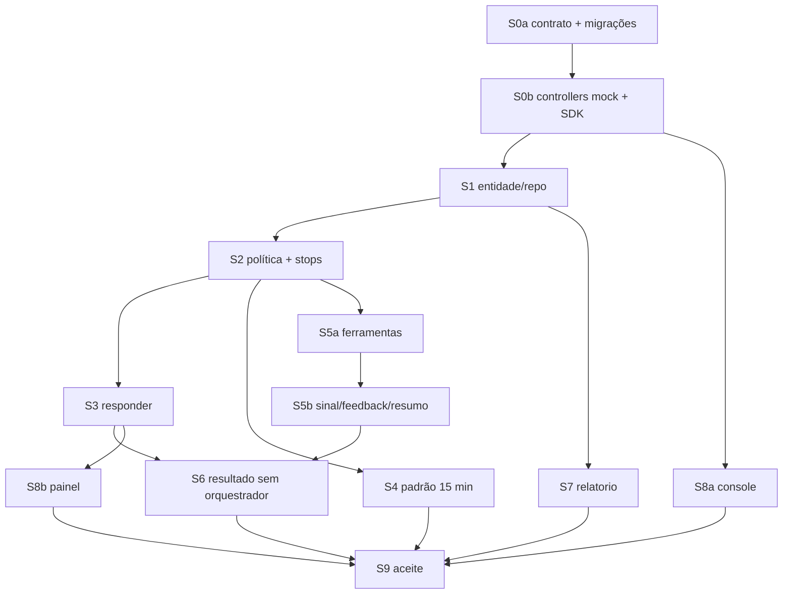

# Fase 3 — emagrecer o grupo — Implementation Plan

> **For agentic workers:** cada slice é um commit (ou poucos) independentemente testável, com RED→GREEN por comportamento. Slices `parallel-*` só saem para subagente com o handoff do slice colado inteiro.

**Goal:** a issue deixa de falar direto no grupo; uma política por grupo decide destino e formato por nível (§6.1); decisões e perguntas viram stops com código (`APP-12 · D1`), respondíveis por citação, código, "sim" solto ou pelo painel; pergunta segue sozinha com o padrão após 15 min; `relatorio` é consulta sem modelo; resultado de tarefa não acorda mais o orquestrador.

**Spec:** `.specs/2026-11-17-emagrecer-o-grupo-design.md` (revisado; ler inteiro antes de qualquer slice).
**Branch:** `feat/fase-3-emagrecer` (a partir de `feat/fase-2-falar`; PR empilhado).
**Slices:** 13 (S0a, S0b, S1–S4, S5a, S5b, S6, S7, S8a, S8b, S9), cada um com ≤ 7 entregáveis.

**Ambiente para todo comando `bun`:** `env -u NODE_ENV -u CODM_MIGRATIONS_DIR -u CODM_PARENT_PID`. Testes de backend a partir de `packages/api/typescript`. Type-check autoritativo: `cd packages/api/typescript && bun x tsc -p tsconfig.build.json --noEmit`.

**Gates de todo slice:** `bun tsc`, `bun lint`, testes do slice + `bun run test` no fim do slice, `bun run detect` (0 erros), varredura de privacidade do `git diff --cached` (sem nomes de cliente, telefones, grupos, textos de conversa). Contrato alterado ⇒ `bun contracts` + `bun sdk` commitados. Migração ⇒ `bun migrate:create` + `db:sync-go` + `db:check-go`.

**Perguntas ao dono que travam slices:** galeria no painel (bucket R2) — sem resposta, S8b entrega só a âncora da issue e o FEEDBACK manda só o print principal (spec, "Pré-requisito"); a matriz nível × modo e o modo padrão (S1 grava o DEFAULT da coluna; S2 grava `ROUTING_BY_MODE`) — implementar com a proposta do spec e trocar só a tabela/DEFAULT se o dono mudar; a régua de quem responde (S3) — idem, é uma tabela; trava dura e modo legado — fora deste plano até resposta.

---

## Wave Plan (task-breakdown)

**Feature Type:** 1 — comportamento novo em entidade existente (`Thread`/`Stop`), controllers e ferramentas MCP novas, telas no console e no painel.
**Contextos:** contracts, `thread`, `agent`, `issue`, `artifact` (só escopo MCP), `panel` (nuvem), app-react.
**Caminho crítico:** `S0a → S0b → S1 → S2 → S3 → S6 → S9` (S6 só depois de S2+S3+S5a+S5b: o resultado não pode deixar de acordar o orquestrador antes de os pedidos chegarem ao grupo pela política).

| Slice | Fase | Depende de | Classificação |
|---|---|---|---|
| S0a Contrato + migrações | 0 | — | serial |
| S0b Controllers declarados (mock) + SDK | 0 | S0a | serial |
| S1 Entidade, repositório, idempotência | 2.W1 | S0b | serial |
| S2 Política + stops no grupo | 2.W1 | S1 | serial (núcleo) |
| S7 `relatorio` | 2.W1 | S1 | parallel-after-contract |
| S3 Responder | 2.W2 | S2 | parallel-after-wave-1 |
| S4 Padrão de 15 min | 2.W2 | S2 | parallel-after-wave-1 |
| S5a Ferramentas da issue | 2.W2 | S2 | parallel-after-wave-1 |
| S5b Sinal, feedback e resumo | 2.W2 | S2, S5a | depois de S5a |
| S8a Console | 1 | S0b (SDK mock); fio real depois de S3 | parallel-after-contract |
| S8b Painel na nuvem | 1/2 | S0b, S3 | parallel-after-wave-2 |
| S6 Resultado sem orquestrador | 2.W3 | S2, S3, S5a, S5b | parallel-after-wave-2 |
| S9 Aceite + medição | 3 | todos | serial |

### Parallelism Matrix

| Kind | Qtde | Classificação dominante |
|---|---|---|
| enum / evento / schema (TypeSpec + `shared/schemas`) | 13 | serial (S0a) |
| migração (SQLite 0036, pg 0007) | 2 | serial (S0a) |
| controller (declarado mock em S0b) | 6 | serial (S0b); real nos slices de comportamento |
| entidade / objeto de valor | 2 (`Thread`+`Stop`, `StopAsk`) | serial (S1) |
| use case / handler / job | ~15 | parallel-after-wave-1 |
| serviço / porta | 3 (`BoardBulletin`, `IssueBoardReader`, `connectedSince`) | parallel |
| tela React / página do painel | 4 | parallel-after-contract |
| fluxo / e2e | 2 | serial (S9) |

---

## S0a — Contrato e migrações (Phase 0, serial)

**Comportamento:** o contrato conhece níveis, modos, efeitos, causas, os kinds/resoluções novos e o sinal de issue; o banco aceita os valores novos; tudo compila com as tabelas totais preenchidas. **Primeiro passo:** uma segunda passada de `spec-review` só nas seções alteradas do spec (as correções da primeira revisão não foram re-revisadas por agente independente).

Entregáveis:
1. Enums TypeSpec (`packages/contracts/src/wire/enums/`): novos `issue-signal-level.tsp`, `group-output-mode.tsp`, `output-routing.tsp`, `ask-effect.tsp`, `block-cause.tsp`; `stop-kind.tsp` += `DECISION_REQUESTED`, `QUESTION_ASKED`, `STALLED`; `stop-resolution.tsp` += `ANSWER`, `DEFAULT_APPLIED`; `panel-action-kind.tsp` += `ANSWER_ASK`; docs de `issue-timeline-item-kind.tsp` (sem kind novo).
2. Eventos: `events/thread-issue-signal.tsp` (`integration.thread.issue_signal`, `level` FEEDBACK/PROGRESS), `thread-stop-raised.tsp` += `ask?`; `index.tsp`.
3. `shared/objects/StopAsk.ts` (o barril que o `registerSchemas` publica; revisão S0a): `AskOptionSchema`, `StopAskSchema`, `AskDefaultSchema`, `AskAnswerSchema`, `StopAnswerSchema` (uniões discriminadas por `kind` = `AskAnswerKind`, enum TypeSpec novo), sem `.refine()`; o payload do sinal é o schema gerado do evento.
4. Tabelas totais exigidas pelo compilador: `RESOLUTIONS_BY_KIND`, `RESUMES_WITH_RESOLVER_POSTURE`, `OFFERED_ON_PANEL` (`thread/utils/StopResolutions.ts`), `NOTIFIES_ON_CHANNEL` (provisório: novos `false`; some em S2), `STOP_TITLES_PT/EN`, `POLICY_KEY` (novos → `humanRequested`, sem coluna nova), `KIND_GATE` do painel (`ANSWER_ASK` recusa até S8b).
5. Drizzle SQLite (`packages/contracts/src/db/sqlite/thread.ts`) + migração `0036` (também reconstrói `thread_panel_actions`, CHECK de `PanelActionKind`; colunas novas de tabelas existentes sem CHECK; `INSERT` da reconstrução de `issue_stops` corrigido à mão) (`bun migrate:create`, `db:sync-go`, `db:check-go`): `thread_threads.output_mode` (DEFAULT `DECISIONS_AND_LIVE`, proposta), `thread_transcript_entries.{level, routing, stop_id, digest_entry_id, addressee_id}` + índice `(thread_id, routing, digest_entry_id)`, `issue_stops` reconstruída (CHECKs novos, `{ask, answer, answered_by, seq, due_at, ask_entry_id}`, único `(issue_id, seq)`, índice `due_at`). No MESMO slice dos enums porque o CHECK é derivado deles (`enumCheck` + `schema-drift.test.ts`): enum sem migração deixa o repo vermelho.
6. Drizzle pg + migração de nuvem `0007` (`panel_actions_kind_check` com `ANSWER_ASK`).
7. `bun contracts` + `bun sdk` commitados; `cargo check` verde; teste da migração: linhas existentes de `issue_stops` sobrevivem com kind/resolução intactos; `StopResolutions.test.ts` com os valores novos.

## S0b — Controllers declarados (mock) e SDK (Phase 0, serial)

**Comportamento:** as rotas e ferramentas novas existem no contrato HTTP/MCP com resposta mock, e o SDK gera os hooks que S8a/S8b consomem antes do backend real.

Entregáveis:
1. `thread/controllers/AnswerStop.ts` (`POST /stops/:stopId/answer`, input `AskAnswerSchema`, CloudSessionMiddleware) — mock.
2. `thread/controllers/ConfigureOutputMode.ts` (`PUT /threads/:threadId/output-mode`, `mcpScopes` system + orchestration, como `ConfigureReactions`) — mock.
3. `agent/controllers/{AskDecision,AskQuestion,RequestFeedback,ReportProgress}.ts` (`static mcpScopes = [ISSUE_HANDLING]`, input compondo `StopAskSchema`/`AskDefaultSchema`) — mock com erro nomeado.
4. `bun emit-openapi && bun sdk`; conferir os nomes gerados (`useAnswerStop`, `useConfigureOutputMode` esperados — conferidos no S0b) e corrigir os handoffs de S8a/S8b se o Kubb gerar outros.
5. Snapshot `agent/mcp/__snapshots__/exposure.test.ts.snap` com as ferramentas novas (a remoção de `SendDirectMessage`/`SendArtifact` do escopo da issue é S5a).

## S1 — Entidade, repositório e "a primeira resolução ganha" (serial)

**Comportamento:** stops guardam pergunta/resposta/prazo; conversa guarda o modo; resolver duas vezes o mesmo stop nunca sobrescreve.

Entregáveis:
1. `thread/objects/StopAsk.ts` (deriva kind por `effects`; pergunta exige `default`) + teste.
2. `thread/entities/Thread.ts`: `StopSchema` com `ask?`/`answer?`/`answeredBy?`; `resolveStop` aceita `ANSWER`/`DEFAULT_APPLIED` com `ASK_OPTION_UNKNOWN`, `ASK_NOT_DUE`, `ASK_ANSWER_REQUIRED` (`thread/errors`); `outputMode` + `configureOutputMode`; `TranscriptEntry` com `level`/`routing`/`stopId`/`digestEntryId`.
3. `LibSqlThreadRepository`: mapeamento; resolução `UPDATE … WHERE id = ? AND resolved_at IS NULL` + linhas afetadas → `STOP_ALREADY_RESOLVED`; `nextAskSeq(issueId, tx)`; `markAskDelivered(entryId, at, tx)` condicional (`WHERE due_at IS NULL`); `findDueAsks(now)`.
4. `thread/usecases/ResolveStop.ts`: lê o stop dentro da transação.
5. Testes: `LibSqlThreadRepository.test.ts` (corrida de resolução, `due_at` uma vez, `seq` único), `Thread.test.ts` (ask/answer/erros).

## S2 — Política de saída e stops no grupo (núcleo, serial)

**Comportamento:** decisões, perguntas e avisos de bloqueio saem no grupo no formato do nível, com código, segundo o modo; um aviso por causa; a parada do reconciliador é `STALLED`.

Entregáveis:
1. `thread/utils/OutputPolicy.ts`: `ROUTING_BY_MODE`, `LEVEL_OF_STOP`, `CAUSE_OF_STOP` (totais) + `OutputPolicy.test.ts`.
2. `thread/usecases/DeliverIssueSignal.ts` (grava entrada com `level`/`routing`, entrega GROUP; DIGEST fica para S5b — aqui cai em GROUP) + formatos `THREAD_MESSAGES.signalFormat` pt/en (DECISION, QUESTION, BLOCK_NOTICE, CLOSING) com link `PanelPublisher.linkOf`.
3. `thread/usecases/RaiseStop.ts`: troca `NOTIFIES_ON_CHANNEL` pela política; para stop com `ask`: `seq`, entrada com `stop_id`, `askEntryId`; um aviso por causa (`CAUSE_OF_STOP` + stops abertos da mesma causa no grupo). `RunIssueTurn.ts` deixa de importar `NOTIFIES_ON_CHANNEL`; a tabela some.
4. `agent/usecases/ReconcileStalledIssues.ts`: parada depois do lembrete grava `StopKind.STALLED`; `IssueLifeState`/`MarkIssueNeedsInputFromStop` aceitam o kind.
5. `NotifyProviderPaused.ts` consulta `ROUTING_BY_MODE[mode][BLOCK_NOTICE]`.
6. `tests/architecture/channel-producers.test.ts` (lista declarada dos 7 produtores + fixture negativa).
7. Testes: `RaiseStop.test.ts` (decisão com código no grupo; pergunta com "sigo com X em 15 min"; segundo `SERVER_ERROR` da mesma causa só no painel; causa fechada reabre; stop da conversa sem issue inalterado), `ReconcileStalledIssues.test.ts` (STALLED → aviso no grupo).

Nota: S2 ainda não cria as ferramentas — testa com stops levantados direto (`given`) com `ask`.

## S3 — Responder (parallel-after-wave-1)

**Comportamento:** citação, código, "sim" solto (uma pendente) ou pelo console resolvem a pergunta certa; duas pendentes ⇒ uma pergunta de desambiguação; resposta atrasada vira steer; a sessão recebe a resposta.

Handoff:
- frozenInputs: `StopResolution.ANSWER`, `AskAnswerSchema` (`OPTION`/`TEXT`), `StopKind.DECISION_REQUESTED|QUESTION_ASKED`, `Thread.resolveStop`, `ThreadRepository` (`stop_id` nas entradas, `STOP_ALREADY_RESOLVED`), `RuleRouter`, `Thread.mayAct`, `Thread.postureOf`, `CONTROL_WORDS`.
- deliverables:
  1. `thread/utils/askAnswer.ts` (`parseAskAnswer`, `BARE_ANSWERS`; teste de disjunção com `CONTROL_WORDS`);
  2. `RuleRouter` + `IngestChannelMessage`: regras 1–4 do spec ANTES de `control()`; régua de quem responde como tabela (`ANSWER_GATE: Record<'WITH_EFFECT'|'NO_EFFECT', …>`); citação/código sem janela de frescor, "sim" solto com `canInvoke` inteiro (portão de menção — teste negativo: "sim" não endereçado num grupo com portão não aprova); `YES_NO_RESOLUTION` para `PERMISSION_DENIED`;
  3. fato `thread.answer_disambiguation_asked` + mensagem de desambiguação (pt/en);
  4. `thread/handlers/ResumeIssueOnStopResolved.ts`: texto com pergunta/código/resposta; sempre enfileira para `ANSWER`/`DEFAULT_APPLIED` (`dedupKey resume:<stopId>`);
  5. `AnswerStop` (declarado em S0b) sai do mock → `ResolveStop`;
  6. testes `IngestChannelMessage.answer.test.ts`, `ResumeIssueOnStopResolved.test.ts`.
- scopeFences: DONE S0a–S2 (não redefinir schemas/tabelas); LEFT esta resolução; OUT painel (S8b), padrão (S4).
- gates: `bun test src/thread`, tsc autoritativo, `bun sdk` (controller novo), `bun run detect`.
- discretion: palavras exatas de `BARE_ANSWERS`; texto da desambiguação.

## S4 — Padrão de 15 minutos (parallel-after-wave-1)

**Comportamento:** a pergunta entregue ao grupo segue sozinha com o padrão 15 min depois; não vence sem entrega, segurada ou na carência após boot/conexão.

Handoff:
- frozenInputs: `ThreadRepository.markAskDelivered/findDueAsks`, `StopResolution.DEFAULT_APPLIED`, `StopAnswerSchema.DEFAULT`, `IssueHold`, `ChannelConnectivity`, `DeliverChannelMessage.recordOutbound`.
- deliverables:
  1. `DeliverChannelMessage.recordOutbound`: marca `due_at` pelo `replyEntryId` (entrada própria ou resumo) na transação existente;
  2. `ChannelConnectivity.connectedSince(channelId)` (porta + implementações por ambiente, alimentada por `channel.connected`);
  3. `thread/usecases/ApplyDueQuestionDefaults.ts` (`repeat.every = 30 s`, `now` de entrada, `QUESTION_DEFAULT_MS`, `DEFAULT_GRACE_AFTER_CONNECT`) registrado em `thread/jobs.ts`;
  4. linha do tempo: "seguiu com o padrão" (+ "o codm estava desligado" quando atrasado > 5 min);
  5. testes `ApplyDueQuestionDefaults.test.ts` (casos do spec).
- scopeFences: DONE resolução idempotente (S1), retomada com resposta (S3 — se S3 não entrou ainda, testar só a resolução); OUT lembretes 2h/6h.
- gates: `bun test src/thread`, tsc, detect.
- discretion: onde guardar o instante do boot.

## S5a — Ferramentas da issue (parallel-after-wave-1)

**Comportamento:** a issue pede decisão, pergunta e feedback e relata progresso por ferramentas próprias; perde `SendDirectMessage`/`SendArtifact`; as ferramentas antigas viram aliases.

Handoff:
- frozenInputs: controllers mock de S0b (`AskDecision`, `AskQuestion`, `RequestFeedback`, `ReportProgress`), `StopAskSchema`, `AskDefaultSchema`, `AskEffect`, `AgentRunStopRaisedEvent` (+ `ask`), `McpScope.ISSUE_HANDLING`, `StopKind.DECISION_REQUESTED|QUESTION_ASKED`.
- deliverables:
  1. use cases `agent/usecases/{AskDecision,AskQuestion}.ts` (fato de stop com `ask`) e os controllers fora do mock;
  2. `agent/usecases/{RequestFeedback,ReportProgress}.ts` (fato `agent.issue_spoke`; `RequestFeedback` confere o artefato como `SendArtifact.ts:48`);
  3. aliases: `DeclareStop` (ferramenta `RaiseStop`), `AskOperator`, `DeclareIssueComplete` NEEDS_INPUT → `DECISION_REQUESTED` com o `ask` do spec;
  4. escopo MCP: `SendDirectMessage`/`SendArtifact` sem `ISSUE_HANDLING`; snapshot de exposição;
  5. prompt `IssueWorkAgent` (quando usar cada ferramenta, `effects`, texto do turno vai ao painel, sem segredos) + `prompt.test.ts`;
  6. testes de contrato de cada ferramenta; pergunta com efeito vira decisão; alias levanta o kind certo.
- scopeFences: DONE política (S2); LEFT ferramentas; OUT entrega do sinal (S5b), fim de turno (S6).
- gates: `bun test src/agent`, tsc, `bun sdk`, detect.
- discretion: limites de tamanho de `question`/`text`; texto do prompt.

## S5b — Sinal de issue, feedback e resumo por pessoa (depois de S5a)

**Comportamento:** o feedback chega ao grupo com o print principal; o progresso fica no painel; perguntas e feedbacks para a mesma pessoa em 60 s saem numa mensagem.

Handoff:
- frozenInputs: `agent.issue_spoke`, `integration.thread.issue_signal`, `DeliverIssueSignal`, `OutputRouting.DIGEST`, `thread/services/ArtifactDelivery`, leitura `reads.artifact`.
- deliverables:
  1. ponte `agent.issue_spoke` → `integration.thread.issue_signal` em `agent/handlers/PublishAgentIntegrationEvents.ts`;
  2. `thread/handlers/RouteIssueSignal.ts` → `DeliverIssueSignal` (FEEDBACK: print principal via `ArtifactDelivery`, legenda "+N no console", link `#<chave>`);
  3. resumo: `routing = DIGEST`, comando `flush_signal_digest` (`jobId digest:<thread>:<pessoa>:<janela>`, `delay 60 s`), `thread/usecases/FlushSignalDigest.ts`; as entradas das perguntas apontam para o resumo (`digest_entry_id`);
  4. testes: 2 → 1 mensagem; 1 → formato normal; decisão nunca agrupa; feedback não trava; PROGRESS não sai no modo padrão.
- scopeFences: OUT galeria (pergunta ao dono).
- gates: `bun test src/thread src/agent`, tsc, detect.
- discretion: texto do resumo.

## S6 — Resultado de tarefa sem orquestrador (parallel-after-wave-2; SÓ depois de S2, S3, S5a, S5b)

**Comportamento:** fim de turno vira PROGRESS no painel; conclusão vira fechamento no grupo; nenhum `ISSUE_RESULT` novo; turno mudo termina em aviso visível.

Handoff:
- frozenInputs: `integration.issue.completed` (`summary`), `agent.issue_spoke`, `DeliverIssueSignal`, `IssueSignalLevel.CLOSING|PROGRESS`, `StopKind.STALLED`.
- deliverables:
  1. `RunIssueTurn.persistOutcome`: sem `enqueueResult`; salva `agent.issue_spoke` PROGRESS com o texto do turno;
  2. `thread/handlers/CloseIssueOnChannel.ts` (`integration.issue.completed` → CLOSING, cita a mensagem de origem; inferida ⇒ "concluída");
  3. `TransitionIssueStatus`/`DeclareIssueComplete`: `finalArtifactId?` (summary inalterado);
  4. `LibSqlMailboxDispatcher.runThreadTurn`: repassa `issueId` ao `RunOrchestratorTurn` (itens drenados);
  5. testes `RunIssueTurn.test.ts` (sem ISSUE_RESULT; texto vira PROGRESS; turno mudo → lembrete → STALLED → aviso no grupo), `CloseIssueOnChannel.test.ts`, `LibSqlMailboxDispatcher` (issueId repassado).
- scopeFences: OUT mudar o orquestrador em conversa geral; `MailboxItemKind.ISSUE_RESULT` continua no contrato.
- gates: `bun test src/agent src/thread`, fluxos de `tests/flows` (os 29 testes de fluxo do `RunIssueTurn` precisam passar ou ser ajustados com motivo), tsc, detect.
- discretion: corte do resumo no fechamento.

## S7 — `relatorio` como consulta (parallel-after-contract, depois de S1)

**Comportamento:** `relatorio` (mensagem inteira) responde com o boletim do grupo e o link, sem turno de modelo.

Handoff:
- frozenInputs: `IssueRepository`, `lifeStateOf` (via serviço novo), stops abertos do `Thread` (`ask`/`seq`), `PanelPublisher.linkOf`, `Thread.canCommand`.
- deliverables:
  1. `thread/enums/ThreadCommand.ts` + `thread/utils/threadCommand.ts` (`THREAD_COMMANDS` com `match: WHOLE_MESSAGE`);
  2. `issue/services/IssueBoardReader.ts` (+ `why` da aresta em `thread/context.ts`);
  3. `thread/services/BoardBulletin.ts` (seções Esperando decisão / Paradas / Fazendo / Concluídas 24 h, máx. 8 por seção, link) + textos pt/en;
  4. despacho em `IngestChannelMessage` (depois das respostas, antes do controle), fato `thread.bulletin_sent`;
  5. testes `IngestChannelMessage.report.test.ts` (sem item THREAD; seções; link só logado; frase longa não é comando).
- scopeFences: OUT boletim periódico; OUT "relatório APP-12".
- gates: `bun test src/thread src/issue`, tsc, detect, `tests/architecture` (context map).
- discretion: ordem dentro das seções.

## S8a — Console (parallel-after-contract)

**Comportamento:** o operador escolhe o modo do grupo; vê e responde perguntas no detalhe da issue; o chat mostra o que ficou só no painel.

Handoff:
- frozenInputs: `GroupOutputMode`, `AskAnswerSchema`, `StopAskSchema`, hooks gerados em S0b (`useConfigureOutputMode`, `useAnswerStop`, `getThreadSettingsQueryKey` — nomes conferidos em S0b).
- deliverables:
  1. `ConfigureOutputMode` real (use case em `ConfigureThreadSettings.ts`, leitura em `GetThreadSettings`);
  2. seletor no `ThreadSettingsDialog` (`bun cli` para o bloco), textos pt/en;
  3. perguntas abertas no detalhe da issue (código, opções, prazo) respondendo por `useAnswerStop` — botão por opção, caixa de texto só quando a pergunta aceita texto (variante por discriminante, `CMP-P18`);
  4. entradas só-painel esmaecidas no chat; `assembleIssueTimeline` + `IssueTimelineItemSchema` com `level`/`routing`/`code`/`answer`;
  5. stories (`*.stories.tsx`) e e2e Playwright (modo + resposta pelo console).
- scopeFences: OUT quadro novo; OUT painel na nuvem (S8b).
- gates: `bun tsc`, `bun lint`, `cd packages/app/react && bun tsr generate` se rota mudar, e2e, detect.
- discretion: layout do seletor e do cartão de pergunta (seguir `design-system`).

## S8b — Painel na nuvem (parallel-after-wave-2)

**Comportamento:** o painel abre a issue por âncora, mostra perguntas com botões por opção e responde com `ANSWER_ASK`; o daemon executa como o membro.

Handoff:
- frozenInputs: `PanelActionKind.ANSWER_ASK`, `PanelActionBodySchema`, `KIND_GATE`, `AskAnswerSchema`, `ExecutePanelAction`, `ResolveStop`, migração pg `0007`.
- deliverables:
  1. nuvem: variante `ANSWER_ASK` em `PanelActionBodySchema`/`KIND_GATE` com a régua de quem responde;
  2. `open_stops` com código, pergunta e opções (daemon `PublishPanelRoster` + schema da nuvem);
  3. `PanelPage`: âncora `#<chave>` abre a issue; botões por opção;
  4. daemon `ExecutePanelAction` → `ResolveStop` + eco `PanelActionEcho.ANSWERED`;
  5. testes `PanelAction.test.ts` (nuvem) e `ExecutePanelAction.test.ts`.
- scopeFences: OUT galeria/R2 (pergunta ao dono); OUT reabrir a identificação da fase 2.
- gates: testes da nuvem, tsc, detect. Deploy: nuvem (`migrate:deploy:cloud` + servidor) antes do daemon — anotar no PR.
- discretion: layout da pergunta na página.

## S9 — Aceite e medição (serial)

Entregáveis:
1. `packages/api/typescript/tests/flows/fase3-typical-task.test.ts` (modo `integration`, runner roteirizado): pedido → issue → `RequestFeedback` → `AskDecision` (efeito PUBLISH) → resposta citada → conclusão; o grupo recebe só recibo, feedback, decisão, fechamento; nenhum PROGRESS no grupo; pergunta de nível 2 segue com o padrão (job com `now` +15 min); `relatorio` sem item THREAD.
2. Dev manual com `bun dev` (`CODM_DATA_DIR` próprio): um grupo de teste, uma tarefa típica; contar mensagens no grupo.
3. "Como medi" no PR: comandos do spec (antes) + os mesmos sobre o banco de dev (depois); repetir sobre cópia do banco real quando o dono instalar.
4. Atualizar `~/Desktop/Projetos/codm-goal-progresso.md` (fora do repo).
5. Gates completos (`bun tsc`, `bun lint`, `bun run test`, e2e, detect, privacidade) e PR em rascunho empilhado sobre a fase 2.

---

## Riscos de execução

- S6 muda o fluxo que ~29 testes de fluxo cobrem (`RunIssueTurn`): ajustar com motivo, nunca apagar a assertiva.
- S0a reconstrói `issue_stops`: rodar a migração sobre uma cópia do banco real (só leitura, em diretório temporário) antes do PR para medir tempo e conferir linhas. No S0a isto ficou coberto só por fixture neutra (`tests/kernel/issue-stops-ask.migration.test.ts`); a passada sobre cópia real é do dono, antes do PR.
- S8b (e a migração pg do S0a) tem deploy da nuvem primeiro; sem ele, o daemon novo tem o snapshot recusado.
