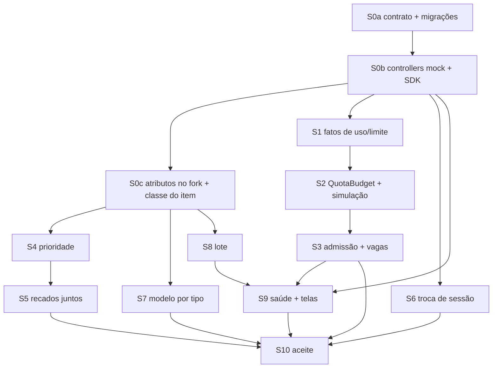

# Fase 4 — vazão — Implementation Plan

> **For agentic workers:** cada slice é um commit (ou poucos) independentemente testável, com RED→GREEN por comportamento. Slices `parallel-*` só saem para subagente com o handoff do slice colado inteiro.

**Goal:** as tarefas rodam no máximo que a cota permite sem estourar a janela: o agendador soma o gasto real por papel (orquestrador, issue, triagem), aprende o teto da janela de 5 h e da semana (corte na recusa, sonda para cima), segura tarefa nova antes do teto menos a reserva do orquestrador (`max(5%, medido)`), abre até 6 vagas quando a máquina aguenta, reivindica por prioridade, junta recados num turno, troca a sessão com notas acima de 120 mil, roda diagnóstico em modelo mais barato, registra destino de cada item de lote e mostra a saúde do sistema.

**Spec:** `.specs/2026-11-19-vazao-design.md` (revisado; ler inteiro antes de qualquer slice).
**Branch:** `feat/fase-4-vazao` (a partir de `feat/fase-3-emagrecer`; PR empilhado).
**Slices:** 13 (S0a, S0b, S0c, S1–S10), cada um com ≤ 7 entregáveis. O "pode publicar" determinístico (spec, item 6c) não tem slice até a resposta do dono.

**Ambiente para todo comando `bun`:** `env -u NODE_ENV -u CODM_MIGRATIONS_DIR -u CODM_PARENT_PID`. Testes de backend a partir de `packages/api/typescript`. Type-check autoritativo: `cd packages/api/typescript && bun x tsc -p tsconfig.build.json --noEmit`.

**Gates de todo slice:** `bun tsc`, `bun lint`, testes do slice + `bun run test` no fim do slice, `bun run detect` (0 erros), varredura de privacidade do `git diff --cached` (sem nomes de cliente, telefones, grupos, textos de conversa; fixtures só com deslocamentos de tempo e contagens). Contrato alterado ⇒ `bun contracts` + `bun sdk` commitados. Migração SQLite ⇒ `bun migrate:create` + `bun run --cwd packages/contracts db:sync-go` + `db:check-go` + o teste de contagem de tabelas do core-go (`TestConcurrentBoot`) atualizado. Migração pg ⇒ `bun migrate:create:cloud`, aplicada na nuvem antes do daemon.

**Perguntas ao dono que travam slices:** desempate de prioridade (S4 implementa a opção (a) como tabela trocável); piso de disco das vagas 5–6 (S3 implementa a tabela proposta; vagas 5–6 só abrem com o piso satisfeito); quando ligar o orçamento (S3 entrega em modo observação); "pode publicar" sem sessão (sem slice).

---

## Wave Plan (task-breakdown)

**Feature Type:** 1 — comportamento novo em serviço/entidade existentes (dispatcher, sessão, fork), agregado novo (`Batch`), ferramentas MCP novas, telas no console e no painel.
**Contextos:** contracts, `agent`, `issue`, `thread`, `ui`, `panel` (nuvem), app-react.
**Caminho crítico:** `S0a → S0b → S1 → S2 → S3 → S10` (o aceite depende do orçamento ligado ao dispatcher).

| Slice | Fase | Depende de | Classificação |
|---|---|---|---|
| S0a Contrato + migrações | 0 | — | serial |
| S0b Controllers declarados (mock) + SDK | 0 | S0a | serial |
| S0c Atributos da tarefa no fork + classe do item | 0 | S0b | serial |
| S1 Fatos de uso com papel e fato de limite | 2.W1 | S0b | serial |
| S2 `QuotaBudget` + simulação de aceite | 2.W1 | S1 | serial (núcleo) |
| S3 Admissão e vagas no dispatcher | 2.W2 | S2 | serial (núcleo) |
| S4 Prioridade na fila | 2.W2 | S0c | parallel-after-contract |
| S5 Recados juntos | 2.W2 | S4 | depois de S4 (mesmo `claimNext`) |
| S6 Troca de sessão com notas | 2.W2 | S0b | parallel-after-contract |
| S7 Modelo por tipo de trabalho | 2.W2 | S0c | parallel-after-contract |
| S8 Lote (backend) | 2.W2 | S0c | parallel-after-contract |
| S9 Saúde + telas (console, painel) | 1/2 | S0b (SDK mock); fio real depois de S3, S8 | parallel-after-contract |
| S10 Aceite + medição | 3 | todos | serial |

S0c é o único escritor de `agent_issue_attributes`, de `ForkIssue` (prioridade, tipo) e do `claimClass` nos produtores; S4, S7 e S8 só consomem (S7 acrescenta a resolução do modelo no `ForkIssue`, depois do S0c). S4 e S5 mexem no mesmo `claimNext`: em sequência, nunca em paralelo.

### Parallelism Matrix

| Kind | Qtde | Classificação dominante |
|---|---|---|
| enum TypeSpec (novo/crescido) + evento `issue.created` | 12 | serial (S0a) |
| schema compartilhado (`shared/objects`) | 4 | serial (S0a) |
| migração (SQLite 0037, pg 0008) | 2 | serial (S0a) |
| controller (mock em S0b) | 5 | serial (S0b); real nos slices |
| fato de domínio | 4 (`AgentUsageEvent` crescido, `limit_observed`, `quota.held`, `handed_off`) | serial (S1, S3, S6) |
| serviço / porta | 8 (`QuotaBudget`, `QuotaLedgerReader`, `MachineCapacity`, `QuotaStatusReader`, `TriageUsageRecorder`, `ForkedIssueReader`, `BatchSequence`, `HandoffNotes`) | serial no núcleo; resto paralelo |
| entidade / agregado | 2 (`Batch` próprio, `AgentSession` crescida) | parallel-after-contract |
| use case / handler | ~8 | parallel-after-contract |
| tela React / página do painel | 3 | parallel-after-contract |
| fluxo / simulação / e2e | 3 | serial (S2, S10) |

---

## S0a — Contrato e migrações (Phase 0, serial)

**Comportamento:** o contrato conhece papéis de uso, janelas de limite, prioridade, tipo de trabalho, destinos de lote e estado de cota; o banco tem as colunas e tabelas; tudo compila com as tabelas totais preenchidas. **Primeiro passo:** segunda passada de `spec-review` por agente independente, só nas seções alteradas pela primeira revisão, desta vez com `docs/BACKEND.md`, `docs/FRONTEND.md` e os `registry.yaml` (a primeira passada não os leu).

Entregáveis:
1. Enums TypeSpec (`packages/contracts/src/wire/enums/`): novos `usage-role.tsp`, `provider-limit-window.tsp`, `issue-priority.tsp`, `priority-reason.tsp`, `issue-work-kind.tsp`, `batch-item-destination-kind.tsp`, `quota-state.tsp`, `slot-limit.tsp`; `issue-life-state.tsp` += `WAITING_BUDGET`; `block-cause.tsp` += `BUDGET_HELD`; `issue-timeline-item-kind.tsp` += `BATCH_LINKED`. Evento `issue.created` += `priority?`, `priorityReason?`, `workKind?`, `model?` (bindings Go/Rust). Enums do `agent` (`agent/enums`): `MailboxClaimClass`, `ProviderLimitStatus`, `HandoffNotesSource`.
2. `shared/objects/QuotaSnapshot.ts` (`QuotaSnapshotSchema`, `PanelHealthSchema` sem números absolutos) e `shared/objects/Batch.ts` (`BatchItemDestinationSchema` — união discriminada por `kind` = `BatchItemDestinationKind`; `BatchItemSchema`; `BatchSchema`), sem `.refine()`, exportados no barril de `shared/objects`.
3. Tabelas totais tocadas (lista do spec): `issue/utils/issueLifeState.ts` (`WAITING_BUDGET` logo depois de `WAITING_PROVIDER`; nunca produzido até o S3), `thread/utils/OutputPolicy.ts` e `thread/i18n/messages.ts` (`BUDGET_HELD` pt/en), `issue/services/BoardBulletin.ts`, leitor da linha do tempo no `ui` (`BATCH_LINKED`), react `IssueCard.tsx` e `IssuesOverviewSection`.
4. Drizzle SQLite + migração `0037`: `agent_mailbox.claim_class` (sem CHECK; `UPDATE` preenche pelo `kind` com a tabela declarada `CLAIM_CLASS_OF_KIND`, que o enqueue também usa até o S0c tornar o campo obrigatório), tabela `agent_issue_attributes` (com `thread_id`, preenchida a partir de `issue_issues` para as issues existentes), `issue_issues.{priority, priority_reason, work_kind, model}` nullable sem CHECK, `agent_agent_sessions.{handoff_notes, handoff_at}`, tabelas `thread_batches`/`thread_batch_items` (CHECKs por `enumCheck`). Conferir o SQL gerado: colunas novas em tabela existente saem como `ADD COLUMN`, nunca reconstrução. `db:sync-go`, `db:check-go`, contagem de tabelas do core-go 31 → 34 (`store_test.go`).
5. Drizzle pg + migração de nuvem `0008`: `panel_batches`, coluna `health` jsonb no estado do grupo, **recriar `panel_issues_life_state_check`** com `WAITING_BUDGET`.
6. `bun contracts` + `bun sdk` commitados; `cargo check` verde.
7. Testes: migração aplicada pelo `LibSqlDriver` real sobre linhas semeadas (`claim_class` derivado do `kind`; issues antigas sem atributos); `schema-drift.test.ts` verde; aplicar a 0037 numa cópia do banco real (fora do repo) antes do PR.

## S0b — Controllers declarados (mock) e SDK (Phase 0, serial)

**Comportamento:** as rotas e ferramentas novas existem no contrato HTTP/MCP com resposta mock, e o SDK gera os hooks de S9.

Entregáveis:
1. `ui/controllers/GetSystemHealth.ts` (`GET /ui/system/health`, saída `QuotaSnapshotSchema`) — mock.
2. `ui/controllers/GetBatch.ts` (`GET /ui/threads/:threadId/batches/:batchCode`, saída `BatchSchema` + chaves das issues) — mock.
3. `thread/controllers/RecordBatch.ts` (`static mcpScopes = [McpScope.ORCHESTRATION]`, input `{ batchCode, items: BatchItemSchema.pick({ n, destination })[] }`) — mock com erro nomeado.
4. `agent/controllers/WriteHandoffNotes.ts` (`static mcpScopes = [McpScope.ISSUE_HANDLING]`, input `{ notes: string 1..8000 }`) — mock.
5. `agent/controllers/ForkIssue.ts` + `ForkIssueInputSchema`: `priority?`, `priorityReason?`, `workKind?` (enums do S0a).
6. `bun emit-openapi && bun sdk`; registrar os nomes gerados (`useGetSystemHealth`, `useGetBatch` esperados) e corrigir os handoffs de S9 se o Kubb gerar outros; snapshot `agent/mcp/__snapshots__/exposure.test.ts.snap` com `RecordBatch`/`WriteHandoffNotes`; rotas novas do `ui` na baseline do registry-scan só se o `detect` exigir (precedente fase 1).

## S0c — Atributos da tarefa no fork e classe do item (Phase 0, serial)

**Comportamento:** toda tarefa nova tem prioridade, motivo e tipo gravados pelo `agent` na transação do fork; o `issue` os recebe pelo `issue.created`; todo item da fila declara a sua classe; o `thread` consegue confirmar que uma issue é daquela conversa no mesmo turno do fork.

Entregáveis:
1. `agent/repositories/IssueAttributesRepository` (porta + `LibSql…` + `Mock…`, `registry.ts` nos três ambientes) sobre `agent_issue_attributes`.
2. `agent/usecases/ForkIssue.ts`: grava a linha (prioridade, motivo, tipo; `model` nulo até o S7) na transação do fork; `IssueForkedEvent` e a ponte `PublishAgentIntegrationEvents` levam os campos ao `issue.created`.
3. `issue`: handler do `issue.created` grava `priority`/`priority_reason`/`work_kind`/`model` em `issue_issues` (projeção de leitura).
4. `agent/services/ForkedIssueReader` (porta lendo `agent_issue_attributes` por `(issue_id, thread_id)`; issues antigas pelo preenchimento da 0037) + nota na aresta `thread → agent` do `context.ts`.
5. `EnqueueMailboxItem.claimClass` obrigatório; os 9 produtores (agent e thread) passam a classe; `ResumeIssueOnStopResolved` declara `DECISION_ANSWER`; o "agora" declara `INTERRUPT`; some o uso de `CLAIM_CLASS_OF_KIND` no enqueue.
6. Testes: `ForkIssue.test.ts` (linha gravada na transação; evento com os campos), `IssueAttributesRepository.test.ts`, `ForkedIssueReader.test.ts` (issue do mesmo turno; issue antiga; outra conversa), `tests/architecture/mailbox-claim-class.test.ts` (produtor sem classe falha; fixture negativa).

## S1 — Fatos de uso com papel e fato de limite (serial)

**Comportamento:** todo turno que gasta cota grava quem gastou, em qual provedor e modelo; toda recusa (e aviso) do provedor vira fato com a janela.

Entregáveis:
1. `agent/events/AgentUsageEvent.ts`: `role`, `provider`, `model`, `windows?` (fronteiras de janela vistas no run) — opcionais no schema, obrigatórios em todo produtor novo; `RunIssueTurn` (`ISSUE`), `RunOrchestratorTurn` (`ORCHESTRATOR`), triagem (`TRIAGE`) por um `agent/services/TriageUsageRecorder` (porta do `agent` com unidade de trabalho própria) chamado de dentro do `ModelInboundTriage` — o `thread` não grava fato do `agent`.
2. `StreamJsonCodec/FrameDecoder.ts`: `RateLimitRecord` ganha `window: ProviderLimitWindow` e `status` (`REJECTED`/`WARNING`/`ALLOWED`) por tabela declarada `RATE_LIMIT_WINDOW: Record<string, ProviderLimitWindow>` (`five_hour`, `seven_day`, `seven_day_overage_included`, …) com `UNKNOWN` para o resto; `allowed_warning` lido; `resetsAt` de linhas `allowed` guardado como fronteira de janela.
3. `agent/events/AgentProviderLimitEvent.ts` (`agent.provider.limit_observed`) gravado pelo `RunIssueTurn`/`RunOrchestratorTurn` quando o run termina com recusa ou aviso; `agent/events/index.ts`.
4. `tests/architecture/usage-role.test.ts`: todo `new AgentUsageEvent(` no `src/` passa `role` (fixture negativa).
5. Testes: `FrameDecoder.test.ts` (mapeamento, `UNKNOWN`, aviso), `RunIssueTurn.test.ts`/`RunOrchestratorTurn.test.ts` (role/provider/model no fato; recusa grava `limit_observed` com `window`), `ModelInboundTriage.test.ts` (fato `TRIAGE`).

## S2 — `QuotaBudget` e simulação de aceite (núcleo, serial)

**Comportamento:** dado o histórico de fatos, o serviço diz se cabe mais um turno de issue nas duas janelas, com a reserva do orquestrador; a simulação com eventos reais anonimizados mostra a pista segurada antes de cada recusa.

Entregáveis:
1. `agent/utils/UsageCost.ts`: `USAGE_COST_WEIGHTS: Record<AgentModelId, Record<UsageBucket, number>>` (origem dos pesos no comentário) e `costOf(usage)`.
2. `agent/services/QuotaBudget/QuotaBudget.ts` (puro, global da conta): `windows(now, facts)`, teto aprendido (semente `QUOTA_SEED_CEILING` ajustada só em W45, corte na recusa/aviso com projeção dos turnos em voo, sonda para cima `QUOTA_PROBE_AFTER`/`QUOTA_PROBE_STEP`, volta à semente na evidência de conta trocada), reserva `max(0.05, parteMedida)` como piso livre (`teto − max(reserva × teto, gastoOrquestrador)`), `admit({ inFlight, now }) → { admitted, reason, snapshot }`, `expectedTurnCost` (média dos últimos 50).
3. `agent/services/QuotaBudget/QuotaLedgerReader.ts` (porta + `LibSql…` lendo `shared_events` por `name`/`occurred_at`, só fatos com `role`; `Mock…` em memória) + `registry.ts` nos três ambientes.
4. `tests/fixtures/quota/usage-2026-11.json`: gerada por script fora do repo a partir da cópia do banco — por turno `{ tMs (deslocamento), role, inputTokens, outputTokens, cacheCreationInputTokens, cacheReadInputTokens }` e `refusals: [{ tMs, window }]`. Sem ids, sem texto. Script descrito no spec ("Como medi").
5. `QuotaBudget.test.ts`: admissão nas duas janelas, reserva com medido acima e abaixo de 5%, corte na recusa, subida na folga, `UNKNOWN`, turnos em voo.
6. `tests/flows/fase4-quota-replay.test.ts` (relógio injetado, laço fechado): a fixture vira demanda e só turnos admitidos são cobrados; recusas de W46–W47 fora da amostra; assertivas do spec (pista fecha antes do limite implícito; caso "recusa mesmo assim" corta o teto e a janela seguinte fecha mais cedo; horas seguradas < pausadas); também com pesos só de saída. A parte "THREAD continua respondendo" é do S3, com o dispatcher.

## S3 — Admissão e vagas no dispatcher (núcleo, serial)

**Comportamento:** a pista ISSUE só abre com admissão do orçamento e vaga efetiva; a pista THREAD nunca é segurada; a tarefa segurada aparece como `WAITING_BUDGET` e o grupo recebe um aviso por causa.

Entregáveis:
1. `agent/services/MachineCapacity` (porta; `real` com `statfs` do volume de dados e pressão de memória; `mock`/`integration` fixos) + tabela `ISSUE_SLOTS_BY_DISK`.
2. `LibSqlMailboxDispatcher.ts`: máximo da pista ISSUE por `CODM_AGENT_ISSUE_SLOTS_MAX` (padrão 6); `effectiveSlots(kind)` = mínimo de máximo, máquina e admissão; admissão consultada a cada volta do laço antes do `claimNext`, ISSUE fora de `open` quando negada (nunca reivindica e devolve); turnos em voo por pista entram no `admit`.
3. Envs `CODM_AGENT_QUOTA_ENFORCE` (padrão `false` = observação) e `CODM_AGENT_ISSUE_SLOTS_MAX` em `ProductConfig` + manifesto do `template.config.ts` com consumidores; fato `agent.quota.held { enforced }` na transição.
4. `agent/services/QuotaStatusReader` (porta de leitura do último `admit` + vagas com `limitedBy` + fila) para `ui` e `issue`; `lifeStateOf` deriva `WAITING_BUDGET` = `QUEUED` + leitor diz segurando; arestas `ui → agent` e `issue → agent` nas notas de `context.ts`.
5. Aviso `BUDGET_HELD` no grupo (política da fase 3, um por causa) com a hora estimada de volta; fecha quando a pista reabre.
6. Testes: `LibSqlMailboxDispatcher.slots.test.ts` (efetiva = mínimo; disco baixo derruba vagas; THREAD não segurada), `LibSqlMailboxDispatcher.quota.test.ts` (observação não segura; ligado segura ISSUE e continua reivindicando THREAD — critério "orquestrador responde com a cota de tarefas esgotada"; nenhuma tentativa gasta).

## S4 — Prioridade na fila (parallel-after-contract)

**Comportamento:** resposta a decisão passa à frente, depois bug de cliente, depois prioridade declarada; nunca fura a fila da própria tarefa.

Entregáveis:
1. `agent/utils/ClaimRank.ts`: `CLAIM_RANK` total sobre (`MailboxClaimClass`, prioridade da tarefa); o `CASE` do SQL é gerado dela; empate por chegada (opção (a)).
2. (consome do S0c: `claim_class` já gravado por todos os produtores; nada a escrever aqui.)
3. `LibSqlMailboxRepository.claimNext`: pistas primeiro; candidato = item mais antigo pronto do alvo (`NOT EXISTS`); alvos pelo menor rank dos prontos (janela por alvo, junção com `agent_issue_attributes`); depois `created_at`; `MockMailboxRepository` igual.
4. Prompt do orquestrador: quando declarar `HIGH`/`LOW` e quando marcar `CLIENT_BUG` (a gravação é do S0c).
5. Testes: `MailboxRepository.rank.test.ts` (decisão à frente; FIFO no alvo com rank melhor num item mais novo; pistas primeiro; empate por chegada; issue antiga pelo preenchimento), teste de contrato da ferramenta `ForkIssue` com prioridade.

Handoff (para subagente):
- **frozenInputs:** `IssuePriority`, `PriorityReason` (de `@codm/contracts-typescript/wire/enums`), `MailboxClaimClass` (`agent/enums`), coluna `agent_mailbox.claim_class`, tabela `agent_issue_attributes`, `ForkIssueInputSchema` com `priority?`/`priorityReason?`/`workKind?` (S0a/S0b), linhas e classes gravadas pelo S0c.
- **deliverables:** os 5 acima; canon: `.claude/skills/repository/typescript`, `usecase/typescript`, `test/typescript`.
- **scopeFences:** DONE: contrato e migração (não redefinir). LEFT: ordem de reivindicação e gravação do rank. OUT: juntar recados (S5), orçamento (S3).
- **gates:** `cd packages/api/typescript && bun test src/agent/repositories src/agent/usecases/ForkIssue.test.ts && bun x tsc -p tsconfig.build.json --noEmit`; `bun run detect`.
- **discretion:** forma do SQL (subconsulta ou janela), nomes de helpers.

## S5 — Recados juntos (parallel-after-contract, depois de S4)

**Comportamento:** os recados prontos de uma tarefa viajam juntos num turno; pausa, adiamento, corte, falha e ☑️/✅ tratam o grupo.

Entregáveis:
1. Porta do repositório sobre conjunto e transacional: `claimNext → ClaimedMailboxBundle { head, followers[] }` (prefixo contíguo de `STEER` com a postura da cabeça, até `MAX_COALESCED = 10`, para no primeiro incompatível — "agora", resposta a decisão, lembrete, outra postura), `renewLease(ids)`, `complete(ids)`, `defer(ids)`, `holdItems(ids)`, `fail(head, followers)` (só a cabeça gasta; seguidores com tentativa devolvida); `firstClaim` por item; `MockMailboxRepository`.
2. `LibSqlMailboxDispatcher.ts`: `runTurn`, heartbeat (renova todos), `holdItem`, `waitForProvider`, `releaseInterrupted`, `recordFailure`/envenenamento e `cueSteer` por item, sobre o grupo.
3. `RunIssueTurn`: prompt com os recados em ordem; `posture`/`firedByLoop` da cabeça; cursor `lastMessageId` e `messageId` de dedup = último item.
4. `IssueTurnAborter.begin` com a entrada do último recado do grupo (um "agora" posterior corta o grupo).
5. Testes: `LibSqlMailboxDispatcher.coalesce.test.ts` (3 recados → 1 turno; prefixo para no "agora" e em outra postura; pausa/adiamento/corte/falha/envenenamento; ☑️/✅ por item; cursor e dedup; crash no meio não parte o grupo), `MailboxRepository.test.ts` (bundle).

Handoff:
- **frozenInputs:** `ClaimedMailboxItem` atual, `TurnReport`, `SteerProgress`, `IssueTurnAborter.begin(targetId, entryId)`; a ordem de S4.
- **deliverables:** os 5 acima; canon: `repository/typescript`, `service/typescript`, `test/typescript`.
- **scopeFences:** DONE: S4. LEFT: grupo de itens. OUT: orçamento, troca de sessão.
- **gates:** `bun test src/agent/services/MailboxDispatcher src/agent/repositories` + `bun run test` + `bun run detect`.
- **discretion:** nomes internos; se o bundle vai como objeto ou como lista com cabeça na posição 0.

## S6 — Troca de sessão com notas (parallel-after-contract)

**Comportamento:** acima de 100 mil de contexto o turno pede notas; acima de 120 mil abre sessão nova com elas (ou com as derivadas); o fio (objetivo, decisões, recados pendentes) não se perde.

Entregáveis:
1. `RunIssueTurn`: `ISSUE_HANDOFF_ASK_AT = 100_000` (retoma e pede `WriteHandoffNotes`) e `ISSUE_CONTEXT_BUDGET = 120_000` passado ao `resumeDecision` (sessão nova com notas da sessão ou derivadas).
2. `agent/usecases/WriteHandoffNotes.ts` + controller real; `AgentSession` (`handoffNotes`, `handoffAt`, `recordHandoff`) + repositório.
3. `agent/services/HandoffNotes` (notas derivadas: objetivo/título, decisões e respostas da linha do tempo, stops abertos, artefatos/links, últimos PROGRESS, branch/`git status` do cwd).
4. Fato `agent.session.handed_off` + item de linha do tempo.
5. Testes: `RunIssueTurn.handoff.test.ts` (aceite: acima de 100 mil pede notas; acima de 120 mil o primeiro prompt da sessão nova contém notas, objetivo, decisão aberta e recado pendente; sem notas → derivadas; abaixo de 100 mil nada muda), `AgentSession.test.ts`.

Handoff:
- **frozenInputs:** `WriteHandoffNotes` (S0b), colunas `handoff_notes`/`handoff_at` (S0a), `ResumeInvalidationReason.CONTEXT_BUDGET_EXCEEDED`, `ORCHESTRATOR_CONTEXT_BUDGET` como precedente.
- **deliverables/canon:** `entity/typescript`, `usecase/typescript`, `service/typescript`, `test/typescript`.
- **scopeFences:** DONE: contrato. LEFT: limiar, notas, sessão nova. OUT: modelo por tipo (S7).
- **gates:** `bun test src/agent` + `bun run test` + `bun run detect`.
- **discretion:** texto do pedido de notas e formato das notas derivadas.

## S7 — Modelo por tipo de trabalho (parallel-after-contract)

**Comportamento:** tarefa declarada `DIAGNOSIS` roda no modelo mais barato da tabela, fixado no fork; retomada nunca troca de modelo.

Entregáveis:
1. `agent/utils/ModelByWorkKind.ts`: `MODEL_BY_WORK_KIND: Record<ProviderKind, Record<IssueWorkKind, ModelChoice>>`, `ModelChoice` = `{ kind: 'CONVERSATION' } | { kind: 'MODEL', model }`.
2. `ForkIssue`: resolve o modelo pela tabela e preenche `agent_issue_attributes.model` (a linha e o `work_kind` já são gravados pelo S0c; o `issue.created` já leva `model`).
3. Dispatcher (`runIssueTurn`): modelo do item ISSUE vem de `agent_issue_attributes`; sem linha (issue antiga), o da conversa; atualizar o docblock que dizia "a issue herda o modelo da conversa".
4. Prompt do orquestrador: quando declarar `DIAGNOSIS`.
5. Testes: `ForkIssue.test.ts` (modelo pela tabela), `LibSqlMailboxDispatcher.test.ts` (item usa o modelo da issue; issue antiga usa o da conversa), `AgentSession` não acusa `MODEL_CHANGED` entre turnos da mesma issue.

Handoff: **frozenInputs** `IssueWorkKind`, `agent_issue_attributes.model/work_kind`, `ForkIssueInputSchema.workKind`; **gates** `bun test src/agent src/issue` + `bun run detect`; **OUT** S6; **discretion** texto do prompt.

## S8 — Lote (backend) (parallel-after-contract)

**Comportamento:** mensagem com lista vira lote `L-<n>`; o orquestrador registra um destino por item (ou a ferramenta recusa dizendo quais faltam); com tudo registrado sai um recibo no grupo; item anexado vira recado para a tarefa.

Entregáveis:
1. `thread/utils/BatchDetector.ts` (≥ 3 itens numerados/marcados) na camada de regra, antes da triagem (lote nunca vai à triagem); o item THREAD leva `{ batchCode, items }`.
2. `thread/entities/Batch.ts` (agregado próprio; invariante "todo item 1..N tem um destino"; `BATCH_ITEMS_MISMATCH`, `BATCH_ISSUE_NOT_IN_THREAD` em `thread/errors`) + repositório (`thread_batches`/`thread_batch_items`) + `thread/services/BatchSequence`.
3. `thread/usecases/RecordBatch.ts` + controller real: valida issues pela porta `agent/services/ForkedIssueReader` (aresta `thread → agent` declarada), grava, enfileira steer para `ATTACHED`, marca `BATCH_LINKED`, recibo determinístico (pt/en em `thread/i18n/messages.ts`) com link do painel, uma vez.
4. Lote `INCOMPLETE` depois do turno: um lembrete no próximo turno do orquestrador; persistindo, aviso `STALLED` da conversa.
5. Testes: `Batch.test.ts`, `RecordBatch.test.ts` (aceite: 10 itens → 10 destinos; 9 → recusa sem recibo; issue de outra conversa recusada; issue forkada no mesmo turno aceita; `ATTACHED` → steer; recibo uma vez), `BatchDetector.test.ts`.

Handoff: **frozenInputs** `BatchItemDestinationSchema`, `BatchSchema`, `BatchItemDestinationKind`, `RecordBatch` (S0b), tabelas (S0a), `ForkedIssueReader` e `claimClass` do steer `ATTACHED` (S0c); **canon** `entity`, `repository`, `usecase`, `errors` (typescript); **OUT** telas (S9); **gates** `bun test src/thread` + `bun run detect`; **discretion** limiar de itens fica 3 (spec), texto do recibo.

## S9 — Saúde e telas (parallel-after-contract)

**Comportamento:** o console mostra a faixa de saúde (cota da janela e da semana, vagas, fila, disco, daemon) e a tela do lote; o painel na nuvem mostra o mesmo (sem números de conta) e o lote pela âncora.

Entregáveis:
1. `ui/usecases/GetSystemHealth.ts` real (lê `QuotaStatusReader`, `MachineCapacity`, fila) e `ui/usecases/GetBatch.ts` real.
2. Console: faixa de saúde em `routes/.../issues/-components/SystemHealthSection` (`useGetSystemHealth`, SSE existente, skeleton inline) — `bun cli` para o scaffold.
3. Console: rota `threads/$threadId/batches/$batchCode` (`bun cli`, `errorComponent`, `bun tsr generate`) com itens, destinos e links.
4. Painel: `issue/usecases/PublishPanelSnapshot` leva `PanelHealthSchema` (só percentuais e estados) e lotes; contexto `panel` grava (`panel_batches`, `health`) e a página mostra `#L-31` e o selo de saúde.
5. Testes: componentes (estados `OK`/`NEAR`/`HOLDING`/`REFUSED`), `PublishPanelSnapshot.test.ts`, `PanelSync.test.ts` (schema novo), e2e da faixa com fixture.

Handoff: **frozenInputs** `useGetSystemHealth`, `useGetBatch`, `QuotaSnapshotSchema`, `PanelHealthSchema`, `BatchSchema` (nomes confirmados no S0b); **canon** `component/react`, `route/react`, `storybook`; **OUT** lógica do orçamento; **gates** `cd packages/app/react && bun x tsc --noEmit && bun test`, e2e da faixa, `bun run detect`; **discretion** layout e cópia.

## S10 — Aceite e medição (serial)

**Comportamento:** os quatro critérios da fase verificados juntos; "Como medi (depois)" no spec.

Entregáveis:
1. `tests/flows/fase4-acceptance.test.ts` (modo `integration`, runner roteirizado, relógio injetado): replay da fixture contra o dispatcher real (pista ISSUE segurada antes da recusa; THREAD continua respondendo); lote de 10 itens → 10 destinos e um recibo; sessão acima do limiar → sessão nova com o fio.
2. Spec: seção "Como medi (depois)" com as consultas para depois da instalação (horas seguradas × pausadas por semana, parte medida do orquestrador pós-fase 3, custo por tarefa, turnos por tarefa, espera pelo `first_claimed_at`).
3. `~/Desktop/Projetos/codm-goal-progresso.md` atualizado (fora do repo).
4. PR em rascunho com "Como medi".
