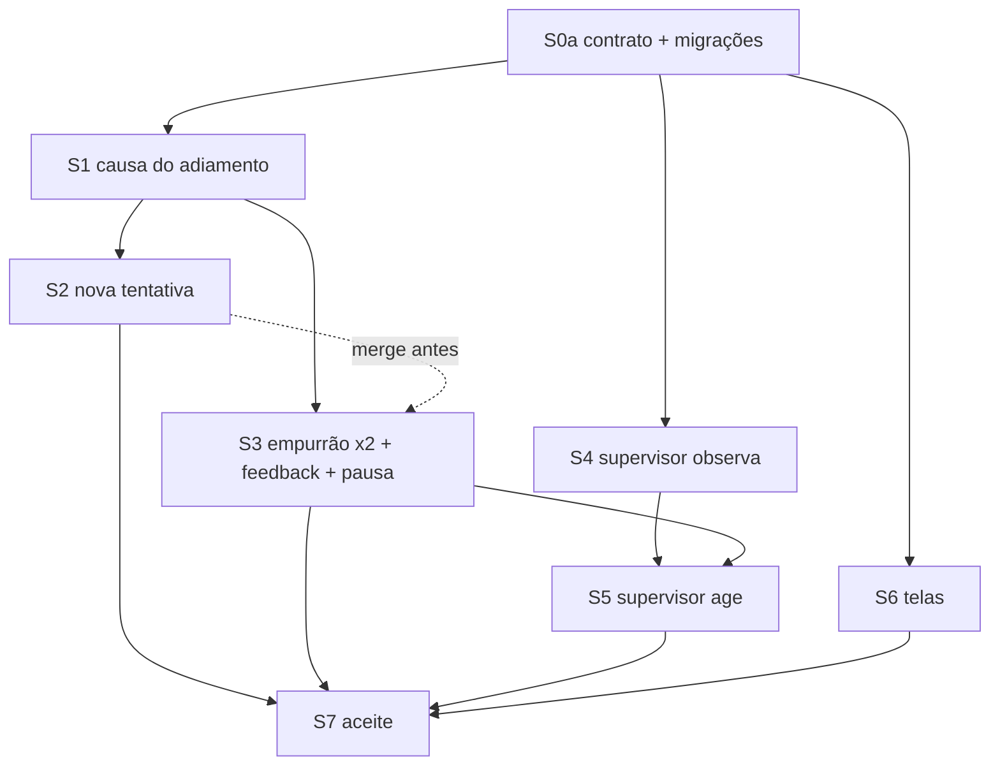

# Fase 5 — autonomia — Implementation Plan

> **For agentic workers:** cada slice é um commit (ou poucos) independentemente testável, com RED→GREEN por comportamento. Slices `parallel-*` só saem para subagente com o handoff do slice colado inteiro.

**Goal:** nenhuma tarefa fica parada sem que o sistema tente antes de pedir alguém — a tarefa que se calou recebe até dois empurrões e só então vira bloqueio visível; quem declarou espera (decisão, pergunta, feedback, pausa, cota, nova tentativa) nunca é empurrado; erro do provedor tenta de novo com espera crescente e, esgotado, pede alguém com a causa certa; um supervisor no modelo pequeno olha as suspeitas a cada 20 min e decide empurrar, reiniciar com as notas ou escalar — agindo desde a instalação, dentro das travas de segurança do spec, com todo veredito registrado.

**Spec:** `.specs/2026-11-20-autonomia-design.md` (revisado por `spec-review` independente, achados aplicados — ver "Revisão" no spec; ler inteiro antes de qualquer slice).
**Branch:** `feat/fase-5-autonomia` (a partir de `feat/fase-4-vazao` 08b7bbe0; PR empilhado).
**Slices:** 8 (S0a, S1–S7), cada um com ≤ 7 entregáveis.

**Ambiente para todo comando `bun`:** `env -u NODE_ENV -u CODM_MIGRATIONS_DIR -u CODM_PARENT_PID`. Testes de backend a partir de `packages/api/typescript`. Type-check autoritativo: `cd packages/api/typescript && bun x tsc -p tsconfig.build.json --noEmit`.

**Gates de todo slice:** `bun tsc`, `bun lint`, testes do slice + `bun run test` no fim do slice, `bun run detect` (0 erros; `git add -N` nos arquivos novos antes), varredura de privacidade do `git diff --cached` com a lista de padrões fora do repo (sem nomes de cliente, pessoas, grupos, telefones, textos de conversa; fixtures só com deslocamentos de tempo e contagens). Contrato alterado ⇒ `bun contracts` + `bun emit-openapi && bun sdk` commitados. Migração SQLite ⇒ `bun migrate:create` + edição à mão + `bun run --cwd packages/contracts db:sync-go` (depois da edição) + `db:check-go`. Migração pg ⇒ `bun migrate:create:cloud`; implantação **nuvem antes do daemon**.

**Antes do S2 (pré-condição de medição, não slice):** com ≥ 5 GiB livres, rodar as consultas de "Como medi (antes)" numa cópia `sqlite3 -readonly … .backup` fora do repo, apagar a cópia, registrar os agregados no spec. Se a medição contradisser o calendário de tentativas ou os limiares de suspeita, ajustar as constantes no spec antes do S2/S4. Sem disco, seguir com os valores do spec e registrar "não medido". A 0038 reconstrói `issue_stops`: aplicá-la numa cópia do banco real antes do PR é obrigatório (mesma regra de disco).

**Decisões do dono (20/11, finais — ver spec):** (1) supervisor age desde a instalação — `ACT` é o padrão a partir do S5 (o S4 entrega o job só registrando, com `OBSERVE` como padrão provisório; o S5 vira o padrão para `ACT`), `OFF`/`OBSERVE` ficam como ajuste e o registro de todo veredito do S4 fica como auditoria; (2) escalar não fala com ninguém novo — selo e linha do tempo; (3) turno vivo mudo nunca é parado pelo supervisor (o vigia de inatividade é o único que mata); (4) feedback sem resposta espera sem prazo; (5) um turno automático por ação do supervisor, contado como o último empurrão; (6) segunda conta/API: ainda não — remedir depois da semana do orçamento.

---

## Wave Plan (task-breakdown)

**Feature Type:** 1 — comportamento novo em serviço/entidade existentes (dispatcher, repositório da fila, reconciliador, sessão, stop), um job e um agente pequeno novos, telas no console e no painel.
**Contextos:** contracts, `agent`, `thread`, `issue`, `ui`, `panel` (nuvem), app-react.
**Caminho crítico:** `S0a → S1 → S2 → S3 → S7` (o aceite depende do empurrão e da nova tentativa reais; o supervisor entra no aceite por configuração de teste).

| Slice | Fase | Depende de | Classificação |
|---|---|---|---|
| S0a Contrato + migrações + tabelas totais | 0 | — | serial |
| S1 Causa do adiamento declarada (sem mudança de comportamento) | 2.W1 | S0a | serial (núcleo) |
| S2 Nova tentativa com espera crescente | 2.W2 | S1 | serial (núcleo) |
| S3 Empurrão até 2 vezes, identidade pela coluna, espera por feedback, pausa da conversa | 2.W2 | S1 (merge depois do S2 por causa do `issueLifeState.ts`) | parallel-after-contract |
| S4 Supervisor: suspeita + decisão em observação | 2.W2 | S0a (S3 para `DeclaredWaitReader` real; antes, `Mock`) | parallel-after-contract |
| S5 Supervisor age (`ACT` ligado por padrão, travas de segurança) | 2.W3 | S4, S3 | serial depois de S4 |
| S6 Telas: estado, linha do tempo, selo (console e painel) | 1 | S0a (SDK); dados reais depois de S2, S3, S5 | parallel-after-contract |
| S7 Aceite + medição | 3 | todos | serial |

**Donos de arquivo** (nunca dois escritores ao mesmo tempo): `LibSqlMailboxDispatcher.ts` e `LibSqlMailboxRepository.ts` — S1, S2, e o `reminderOf`/`hasUnreadSteer` no S3, nessa ordem; `ReconcileStalledIssues.ts`, `LibSqlStalledIssueReader.ts`, os seis leitores de lembrete — S3; `issue/utils/issueLifeState.ts` — S0a (membro), S1 (causa), S2 (`WAITING_RETRY`), S3 (`declaredWait`), nessa ordem de merge; `StopResolutions.ts`, `Thread.ts`, `ResumeIssueOnStopResolved.ts`, `ExecutePanelAction.ts`, `PublishAuthorizedBy.ts` — S0a (tabelas de `AUTO_RETRY`, `RESUME_CLAIM_CLASS`) e S5 (`ApplySupervisorRetry`); `composition/policy.ts` — S5; `RunIssueTurn.ts` — S3 (classe no input) e S5 (`SEEDS_FROM_NOTES`); telas — só S6.

### Parallelism Matrix

| Kind | Qtde | Classificação dominante |
|---|---|---|
| enum TypeSpec novo/crescido | 8 (4 novos, 4 crescidos) | serial (S0a) |
| enum do `agent` | 3 (`MailboxFailureClass`, `SupervisorMode`, `ResumeInvalidationReason` crescido) | serial (S0a) |
| schema compartilhado / união da linha do tempo / DTO | 3 membros + `retryingAt` + `escalatedAt` | serial (S0a) |
| migração (SQLite 0038 com reconstrução de `issue_stops`, pg 0009) | 2 | serial (S0a) |
| fato de domínio | 3 novos + `handed_off.reason` | S2, S3, S4, S5 |
| serviço / porta | 6 (`DeclaredWaitReader`, `SuspectIssueReader`, `IssueSupervisor`, `IssueTimelineReader`, `SmallModelUsageRecorder`, `QuotaStatusReader.providerPausedUntil`) | S3, S4 |
| use case / job | 3 (`SuperviseSuspectIssues`, `ActOnSupervisorVerdict`, `ApplySupervisorRetry`) | S4, S5 |
| entidade | 2 (`AgentSession.requestHandoff`, tabelas do `Thread`) | S0a, S5 |
| rail de arquitetura | 4 (`defer` com causa, `recordFailure` com classe, identidade do lembrete, `POLICY_EXCEPTIONS`/`context-map`) | S1–S5 |
| tela React / página do painel | 2 | S6 |
| fluxo de aceite / e2e | 2 | S6, S7 |

---

## S0a — Contrato, migrações e tabelas totais (Phase 0, serial)

**Comportamento:** o contrato conhece a causa do adiamento, a fonte do empurrão, os motivos de suspeita, os vereditos, `WAITING_RETRY`, `AUTO_RETRY`, o papel `SUPERVISOR` e os três itens da linha do tempo; o banco tem as colunas e o CHECK novo; os lembretes antigos estão convertidos; tudo compila com as tabelas totais preenchidas e **nenhum comportamento muda** (nada produz os valores novos ainda).

Entregáveis:
1. TypeSpec (`packages/contracts/src/wire/enums/`, cada `.tsp` novo importado no `main.tsp`): novos `mailbox-defer-cause.tsp`, `nudge-source.tsp`, `suspicion-reason.tsp`, `supervisor-verdict.tsp`; crescem `issue-life-state.tsp` (+`WAITING_RETRY`, `@doc`), `stop-resolution.tsp` (+`AUTO_RETRY`), `usage-role.tsp` (+`SUPERVISOR`), `issue-timeline-item-kind.tsp` (+`NUDGED`, `RETRY_SCHEDULED`, `SUPERVISOR_REVIEWED`). Enums do `agent`: `MailboxFailureClass`, `SupervisorMode`, `ResumeInvalidationReason += HANDOFF_REQUESTED`. `bun contracts` **antes** das migrações.
2. `shared/schemas/IssueTimelineItemSchema.ts` += os três membros; `agent/objects/NudgePayload.ts` (`NudgePayloadSchema`: `nudge { ordinal, rootItemId?, source }`); DTOs `GetIssuesOverview`/`GetIssueDetail` += `retryingAt?`, `escalatedAt?` (vazios até S2/S5); `AgentSessionHandedOffEvent += reason?`.
3. Tabelas totais com os valores da tabela do spec ("Contrato primeiro", cada linha): `issueLifeState.ts`, `thread/services/BoardBulletin/BoardBulletin.ts`, `StopResolutions.ts` (`RESOLUTIONS_BY_KIND`, `RESUMES_WITH_RESOLVER_POSTURE`, `GIVEN_BY_NAME_ALONE`, `OFFERED_ON_PANEL`), `Thread.ts` (`ANSWER_RECORDED_BY`), `ExecutePanelAction.ts` (`ANSWER_ECHO`), `ResumeIssueOnStopResolved.ts` (`RESUMES_EVEN_WITH_PENDING`, `RESUME_TEXT`, **novo** `RESUME_CLAIM_CLASS` — `AUTO_RETRY → REMINDER`, resto `DECISION_ANSWER`), `agent/objects/PublishAuthorizedBy.ts` (`AUTO_RETRY: () => false`), `thread/i18n/messages.ts` (`ROW_DETAIL_PT/EN`), react `glyphs.tsx` (`resolutionIsPrimary`), `QuotaBudget.ts` (`RESERVED_ROLES[SUPERVISOR] = true`), leitor `issueTimeline.ts` (fontes dos três fatos, vazias até S2/S3/S5), react `IssueCard.tsx`, `IssuesOverviewSection` e renderizadores da linha do tempo (console e painel) com o texto mínimo de cada membro.
4. Drizzle SQLite + migração `0038`: `agent_mailbox.defer_cause` (text nullable, sem CHECK), `agent_agent_sessions.handoff_requested_at`; **reconstrução de `issue_stops`** pelo CHECK de `StopResolution` (revisar o `__new_issue_stops` linha a linha contra a 0036: só colunas existentes, os dois CHECKs, todos os índices, `PRAGMA foreign_keys`); `UPDATE`s à mão: adiados existentes → `HOLD` (issue ou conversa pausada) / `PROVIDER_LIMIT` (resto); lembretes antigos — `WHERE json_extract(payload,'$.declarationReminder') = 1` (a 0037 os deixou `STEER`) — → `claim_class = 'REMINDER'` e payload com `nudge { ordinal: 1, source: 'RECONCILER' }` sem `declarationReminder`. `db:sync-go` depois da edição, `db:check-go`; conferir que o Go lê `agent_mailbox`/`issue_stops` por lista explícita de colunas (sem `sqlc generate` se sim).
5. Drizzle pg + migração `0009`: recriar `panel_issues_life_state_check` com `WAITING_RETRY`; `panel_issues.retrying_at`, `panel_issues.escalated_at` (timestamptz nullable); conferir CHECKs de `IssueTimelineItemKind`/`StopResolution` na nuvem e recriar se fecharem; `SyncPanel` aceita `retryingAt?`, `escalatedAt?` e o enum regenerado.
6. `bun contracts` + `bun emit-openapi && bun sdk` commitados; `cargo check` verde.
7. Testes: migração 0038 pelo `LibSqlDriver` real sobre linhas semeadas (adiado pausado → `HOLD`, não pausado → `PROVIDER_LIMIT`, não adiado → nulo; lembrete antigo → `REMINDER` + `ordinal 1`; stops preservados com índices; stop com `AUTO_RETRY` grava); `schema-drift.test.ts`; `ResolveStop` recusa `AUTO_RETRY` e `GetNeedsYouPanel`/`ExecutePanelAction` não o oferecem nem aceitam; 0038 numa cópia do banco real quando houver disco (fora do repo).

## S1 — Causa do adiamento declarada (núcleo, serial, sem mudança de comportamento)

**Comportamento:** todo adiamento grava a causa; toda escrita que limpa o lease a zera; todo leitor e soltador decide pela causa, não por junção com `paused`; com só `PROVIDER_LIMIT` e `HOLD` em uso, os testes das fases 0–4 continuam verdes sem edição de expectativa.

Entregáveis:
1. `agent/repositories/MailboxRepository` (porta + `LibSql…` + `Mock…`): `defer(ids, until, cause)`; **toda escrita que limpa ou troca o lease zera `defer_cause`** (claim, `giveBack`, `releaseDeferred`, `releaseOrphanedClaims`, `complete`, `settleHold`, morte); `deferred(…)` devolve a causa e `releaseDeferred(ids)` re-afirma o predicado.
2. `agent/utils/DeferRelease.ts`: `DEFER_RELEASE: Record<MailboxDeferCause, { onProviderCredit, onIssueResume, onNewItem }>` com os valores do spec (`RETRY` já declarado, sem produtor). Não há soltura no boot nem sonda nesta linha (#69) — não inventar.
3. `LibSqlMailboxDispatcher.ts`: `holdItem` → `HOLD`, `waitForProvider` → `PROVIDER_LIMIT`; `creditAcceptedTurn` solta pela tabela; `issue/handlers/ReleaseIssueWorkOnResume.ts` solta pela tabela.
4. `issue/utils/providerWaitByIssue.ts` conta só `PROVIDER_LIMIT` (sai a junção com `paused`); `issueLifeState.ts` — `PendingItem.deferred` vira `deferCause?: MailboxDeferCause`.
5. `tests/architecture/mailbox-defer-cause.test.ts`: todo `defer(` no `src/` passa causa (fixture negativa).
6. Testes: `LibSqlMailboxRepository.defer.test.ts` (causa gravada; cada escrita que limpa lease zera; filtros), `ProviderWait.test.ts` e `LibSqlMailboxDispatcher*.test.ts` verdes sem mudança de expectativa.

## S2 — Nova tentativa com espera crescente (núcleo, serial)

**Comportamento:** uma falha que pede nova tentativa volta à fila depois de uma espera que cresce, por pista e classe; um recado novo solta a espera sem avançar o calendário; esgotado o calendário, o stop sai com a causa certa; a tarefa mostra "nova tentativa às hh:mm".

Entregáveis:
1. `agent/utils/RetrySchedule.ts`: `RETRY_SCHEDULE: Record<MailboxTargetKind, Record<MailboxFailureClass, readonly number[]>>` (valores do spec), `FAILURE_CLASS_OF_TRANSPORT_STOP`, `STOP_OF_FAILURE: Record<MailboxFailureClass, StopKind>`; some o `MAX_ATTEMPTS` global.
2. `LibSqlMailboxDispatcher.recordFailure(bundle, { class, detail })`: os três chamadores classificam (transporte pela tabela, exceção `CRASH`, teto `ABANDONED`); `raiseStopForPoisoned` usa `STOP_OF_FAILURE` e diz tentativas e tempo no `detail`.
3. `MailboxRepository.fail(head, followers, failure, schedule, tx)`: `attempts < schedule.length + 1` ⇒ adiado `RETRY` até `now + schedule[attempts-1]`, ou **semântica de `giveBack`** quando a espera é 0 (nunca `lease = now`); senão morto. Seguidores voltam sem custo (como hoje).
4. `agent/events/AgentRetryScheduledEvent.ts` (`agent.mailbox.retry_scheduled`, sem texto de erro) na **mesma unidade de trabalho** do `fail` (o dispatcher abre a transação, como em `holdItem`); `EnqueueMailboxItem` solta o `RETRY` do mesmo alvo (`DEFER_RELEASE.onNewItem`) **devolvendo a tentativa**.
5. Leituras: `issueLifeState.ts` (`RETRY` → `WAITING_RETRY`), `retryingAt` em `GetIssuesOverview`/`GetIssueDetail` (função irmã de `providerWaitByIssue`) e no snapshot do painel, `RETRY_SCHEDULED` no leitor `issueTimeline.ts`.
6. `tests/architecture/mailbox-failure-class.test.ts`: todo `recordFailure(` passa classe (fixture negativa).
7. Testes: `LibSqlMailboxDispatcher.retry.test.ts` (relógio roteirizado: calendário ISSUE e THREAD; espera 0 = `giveBack`; login esgotado → `AUTH_REQUIRED`; exceção; teto; `spoke` não repete; `retryAfter` não gasta; `creditAcceptedTurn` e retomada da issue não soltam `RETRY`; três recados na mesma espera não avançam o calendário e viajam juntos; nunca "esperando cota"; fato atômico com o `fail`), `issueLifeState.test.ts`, `ProviderWait.test.ts`.

## S3 — Empurrão até 2 vezes, identidade pela coluna, espera por feedback, pausa da conversa (parallel-after-contract)

**Comportamento:** a tarefa que se calou recebe o empurrão 1 (declarar) e o 2 (terminar o passo e declarar); calada de novo, vira `STALLED` com aviso no grupo; quem pediu feedback no último turno e quem está em conversa pausada não são empurrados; "é lembrete" passa a ser a coluna em todo leitor.

Entregáveis:
1. Identidade pela coluna nos seis leitores — `LibSqlStalledIssueReader`, `LibSqlMailboxRepository.hasUnreadSteer`, `issueLifeState.ts`, `issueTimeline.ts` (mostra `NUDGED` no lugar do item `STEER` do lembrete), `reminderOf` no dispatcher, `RunIssueTurn` (recebe a classe no input; turno `REMINDER` mudo no grupo) —; `declarationReminder` sai dos produtores; rail `tests/architecture/reminder-identity.test.ts` (fixture negativa).
2. `agent/services/DeclaredWaitReader` (porta + `LibSql…` + `Mock…`, `SIGNAL_DECLARES_WAIT: Record<SpokenLevel, boolean>`): lê os fatos `agent.issue_spoke` da própria issue em `shared_events` (molde `LibSqlHandoffNotes`) — nível que declara espera e `occurred_at ≥ first_claimed_at` do último item consumido, filtrado pelo `entity_id`. Sem coluna, sem handler.
3. `StalledIssueReader`: `StalledIssueRef.lastNudge?: { ordinal, rootItemId }` pela coluna + `NudgePayloadSchema`; exclui conversa pausada pelo `IssueHold` e espera declarada pelo `DeclaredWaitReader`.
4. `agent/usecases/ReconcileStalledIssues.ts`: `NUDGES_BEFORE_STALL = 2`, `NUDGE_TEXT: Record<1 | 2, string>`, `DETAIL_AFTER_NUDGES`, `dedupKey` `nudge:<issueId>:<rootItemId>:<ordinal>`, AUTO, `REMINDER`; fato `agent/events/AgentIssueNudgedEvent.ts` na transação do enqueue.
5. `issueLifeState.ts`: entrada `declaredWait` ⇒ `WAITING_PERSON` antes de `STALLED`; `lifeStateByIssue` pergunta ao `DeclaredWaitReader` (superfície `services` da aresta `issue → agent`, nota no `issue/context.ts`).
6. Testes: `ReconcileStalledIssues.test.ts` (os do spec, inclusive os **negativos** um por linha da lista fechada — conversa pausada incluída —, 5 passadas cada), `LibSqlStalledIssueReader.test.ts`, `DeclaredWaitReader.test.ts`, `issueLifeState.test.ts`, `RunIssueTurn.test.ts`, `LibSqlMailboxRepository` (`hasUnreadSteer` pela coluna).

Handoff:
- **frozenInputs:** `NudgePayloadSchema`, `NudgeSource.RECONCILER`, `IssueTimelineItemKind.NUDGED`, `MailboxClaimClass.REMINDER`, lembretes antigos já convertidos pela 0038 (S0a); `MailboxDeferCause` gravado em todo adiamento (S1); `IssueSpokeEvent`/`SPOKEN_LEVELS`, `IssueHold`, `LibSqlHandoffNotes` (molde), `MarkIssueNeedsInputFromStop` (existentes).
- **deliverables/canon:** `usecase`, `service`, `event`, `repository`, `test` (typescript); `bounded-context` (nota de aresta).
- **scopeFences:** DONE: contrato, colunas, conversão dos lembretes antigos, causa do adiamento. LEFT: identidade pela coluna, contagem, textos, fato, espera por feedback, pausa da conversa, estado. OUT: supervisor (S4/S5), nova tentativa (S2), telas (S6).
- **gates:** `cd packages/api/typescript && bun test src/agent src/issue` + `bun run test` + `bun run detect`.
- **discretion:** redação dos dois textos (o 2 tem de dizer que não autoriza publicar/merge/irreversível), nomes dos helpers.

## S4 — Supervisor: suspeita por regra e decisão em observação (parallel-after-contract)

**Comportamento:** a cada 20 min, as issues suspeitas por regra (no máximo 5, mais antigas primeiro, com esfriamento) são vistas pelo modelo pequeno, sem ferramentas; o veredito fica registrado (`acted: false`) e nada mais acontece; com o provedor pausado ou o orçamento segurando de fato, a passada é pulada.

Entregáveis:
1. `agent/services/SuspectIssueReader` (porta + `LibSql…` + `Mock…`): os quatro motivos e as exclusões do spec (pausa pelo `IssueHold`, espera pelo `DeclaredWaitReader`); constantes `SUSPECT_STOP_AGE_MS`, `NUDGE_LOOP_EPISODES`, `SILENT_TURN_MIN_MS`, `SILENT_TURN_QUIET_MS`, `SUPERVISOR_COOLDOWN_MS`; registry nos três ambientes; aresta **nova** `reads.thread` (`issue_stops`, `threads.paused`) em `agent/context.ts` e `TABLE_READ_EDGES`.
2. `agent/agents/SupervisorAgent` (prompt + tipos, molde `TriageAgent`) e `agent/services/IssueSupervisor` (porta; `ModelIssueSupervisor` com `smallModelFor`, `--tools ""`, `SUPERVISOR_TIMEOUT_MS`, `SUPERVISOR_MIN_CONFIDENCE`, `VERDICTS_BY_REASON`, falha fechada em `LEAVE`; `Mock…` roteirizado). Entrada só com nomes e textos, texto livre por `redactForModel` (≥ 8 dígitos e `@` → `[omitido]`); saída `{ verdict, confidence }`, sem nota livre. Linha do tempo pela porta nova `issue/services/IssueTimelineReader` (envolve `assembleIssueTimeline`).
3. `FactTriageUsageRecorder`/`TriageUsageRecorder` → `SmallModelUsageRecorder` (papel como campo; triagem `TRIAGE`, supervisor `SUPERVISOR`), sem mudar o fato da triagem.
4. `QuotaStatusReader.providerPausedUntil()` exposto pelo dispatcher.
5. `agent/usecases/SuperviseSuspectIssues.ts` (job, `SUPERVISOR_INTERVAL_MS`, `SUPERVISOR_MAX_PER_PASS`) + `agent/events/AgentSupervisorReviewedEvent.ts`; `CODM_AGENT_SUPERVISOR_MODE` no manifesto de env (`template.config.ts`, com consumidores), `.env.example` e `ProductConfig`, padrão `OBSERVE`; `OFF` não registra o job.
6. Notas das arestas (`agent/context.ts`: `reads.thread`, `consumes.issue` — `IssueTimelineReader`, `IssueHold`); `context-map.test.ts` verde.
7. Testes: `SuspectIssueReader.test.ts`, `ModelIssueSupervisor.test.ts` (runner falso; sentinelas de dígitos e `@` redigidas), `SuperviseSuspectIssues.test.ts` (`OBSERVE` não muda nada; `OFF`; provedor pausado pula), `QuotaBudget.test.ts` (`SUPERVISOR` na reserva).

Handoff:
- **frozenInputs:** `SuspicionReason`, `SupervisorVerdict`, `UsageRole.SUPERVISOR`, `SupervisorMode`, `RESERVED_ROLES` (S0a); `DeclaredWaitReader` (S3; antes dele, o `Mock` que diz "sem espera"); `IssueHold`, `assembleIssueTimeline`, `FactTriageUsageRecorder`, `ModelInboundTriage`, `TriageAgent`, `smallModelFor`, `AgentRunnerFactory`, `QuotaStatusReader`, `issue_terminal_lines.at`, `agent.issue.nudged` (S3; antes, `NUDGE_LOOP` lê zero).
- **deliverables/canon:** `service`, `usecase`, `event`, `test` (typescript); `bounded-context` (registry, `context.ts`).
- **scopeFences:** DONE: contrato. LEFT: suspeita, decisão, fato, modo, arestas. OUT: executar veredito (S5), telas (S6).
- **gates:** `bun test src/agent src/issue` + `bun run test` + `bun run detect`.
- **discretion:** redação do prompt (curta, só os vereditos admitidos para o motivo), formato da entrada.

## S5 — Supervisor age (serial depois de S4; `ACT` ligado por padrão)

**Comportamento:** em `ACT`, `NUDGE` resolve o `STALLED`/`SERVER_ERROR` por `AUTO_RETRY` e a tarefa retoma em AUTO como último empurrão do episódio; `RESTART_WITH_NOTES` faz o próximo turno abrir sessão nova com as notas; `ESCALATE` aparece no cartão e na linha do tempo; teto por issue por dia. `ACT` passa a ser o padrão (decisão do dono, 20/11); em `OBSERVE` nada disso acontece e em `OFF` o job não roda. O supervisor nunca faz merge, publica, muda prioridade nem fala com ninguém.

Entregáveis:
1. `thread/usecases/ApplySupervisorRetry.ts` (porta do job, irmã do `ApplyDueQuestionDefaults`; recusa stop fechado ou kind fora de `RESOLUTIONS_BY_KIND`; primeira resolução vence); a retomada sai `REMINDER` com `nudge { ordinal: NUDGES_BEFORE_STALL, source: SUPERVISOR }`; entrada nova em `packages/api/typescript/composition/policy.ts` `POLICY_EXCEPTIONS` para `agent/usecases/ActOnSupervisorVerdict.ts` → `thread` usecases, com a justificativa do spec.
2. `agent/entities/AgentSession.ts`: `requestHandoff(at)` (`handoff_requested_at`), `resumeDecision` checa o pedido **antes** do orçamento e devolve `HANDOFF_REQUESTED`; `RunIssueTurn`: `SEEDS_FROM_NOTES: Record<ResumeInvalidationReason, boolean>` no lugar do `if (decision.reason !== CONTEXT_BUDGET_EXCEEDED)`; `completeHandoff` limpa o pedido; `handed_off` grava `reason`.
3. `agent/usecases/ActOnSupervisorVerdict.ts`: mapa veredito → porta (spec, item 3); restart **sem stop** enfileira o empurrão `REMINDER` com `ordinal = NUDGES_BEFORE_STALL`; issue sem sessão ⇒ pedido ignorado e registrado; `SUPERVISOR_ACTIONS_PER_DAY` e `SUPERVISOR_MAX_ACTIONS_PER_ISSUE_PER_DAY = 3`, passou de qualquer teto ⇒ `ESCALATE` uma vez, depois `LEAVE`; nunca age em issue pausada nem em turno vivo; nenhum texto do modelo vai à sessão; padrão de `CODM_AGENT_SUPERVISOR_MODE` vira `ACT` (manifesto, `.env.example`, `ProductConfig`).
4. `SUPERVISOR_REVIEWED` na linha do tempo só com `acted: true`; `escalatedAt` em `GetIssuesOverview`/`GetIssueDetail` e no snapshot do painel (último `ESCALATE` agido sem stop resolvido nem turno declarado depois).
5. Testes: `ApplySupervisorRetry.test.ts`, `AgentSession.test.ts` (`HANDOFF_REQUESTED` e ordem), `RunIssueTurn.handoff.test.ts` (troca pedida com contexto pequeno; `reason`), `ActOnSupervisorVerdict.test.ts` (cada veredito; AUTO mesmo depois de um `APPROVE` de quem pode liberar; não passa à frente de `DECISION_ANSWER` nem dispara publicação; calado depois da retomada ⇒ `STALLED` direto; teto; pausada), `SuperviseSuspectIssues.test.ts` (`ACT`), rail de `POLICY_EXCEPTIONS`; rail `tests/architecture/supervisor-reach.test.ts` (`SUPERVISOR_ALLOWED_PORTS`; fixture negativa com porta de publicação/envio); teste de que cada ação agida grava o fato com `reason` e `verdict`.

## S6 — Telas: estado, linha do tempo, selo (parallel-after-contract)

**Comportamento:** quadro e painel mostram "nova tentativa às hh:mm (3 de 5)", os empurrões e o que o supervisor fez na linha do tempo, e o selo de escalado; nada de observação aparece.

Entregáveis:
1. Console: `IssueCard.tsx` e o detalhe com `WAITING_RETRY` + `retryingAt` (com dia quando não é hoje, como o "esperando cota") e o selo por `escalatedAt`.
2. Console: renderizadores de `NUDGED` ("empurrão 1 de 2"), `RETRY_SCHEDULED`, `SUPERVISOR_REVIEWED` por variante (Non-Negotiable 3, dispatch por mapa); `AUTO_RETRY` na linha de stop resolvido.
3. Painel: `PublishPanelSnapshot` leva `retryingAt`, `escalatedAt` e os itens novos (colunas da pg 0009); a página renderiza os mesmos estados.
4. i18n pt/en (console e painel).
5. Testes: componentes por variante, `PublishPanelSnapshot.test.ts`, `PanelSync.test.ts`; e2e com fixture (cartão `WAITING_RETRY` + item `NUDGED`).

Handoff:
- **frozenInputs:** `IssueLifeState.WAITING_RETRY`, `StopResolution.AUTO_RETRY`, `IssueTimelineItemKind.{NUDGED,RETRY_SCHEDULED,SUPERVISOR_REVIEWED}`, a união `IssueTimelineItemSchema`, `retryingAt` e `escalatedAt` nos DTOs gerados pelo `bun sdk` do S0a (conferir os nomes dos hooks de overview, detalhe e linha do tempo em `packages/client/dist/typescript` antes de começar; nunca `fetch`).
- **deliverables/canon:** `component/react`, `storybook`; painel segue o renderizador existente.
- **scopeFences:** DONE: contrato e DTOs. LEFT: telas e textos. OUT: lógica de backend.
- **gates:** `cd packages/app/react && bun x tsc --noEmit && bun test`, e2e da fixture, `bun run detect`.
- **discretion:** layout, ícones e cópia.

## S7 — Aceite e medição (serial)

**Comportamento:** o critério da fase verificado ponta a ponta; "Como medi (depois)" no spec; números do item 4 no PR.

Entregáveis:
1. `tests/flows/fase5-acceptance.test.ts` (modo `integration` — precedente do aceite da fase 4 —, dispatcher real, runner roteirizado, relógio injetado): os quatro casos do spec, "Testes → Aceite".
2. Spec: "Como medi (depois)" — o que o aceite imprime e as consultas para depois da instalação (empurrões por ordinal e o que veio depois, `STALLED` por semana, tentativas por classe e quantas passaram antes do stop, tempo do stop à resolução, vereditos em observação por motivo, horas paradas pelo provedor).
3. Se houver disco: rodar o "antes" se ainda não rodou, e a 0038 numa cópia do banco real; registrar.
4. `~/Desktop/Projetos/codm-goal-progresso.md` atualizado (fora do repo); PR em rascunho com "Como medi", os números do item 4 e as decisões do dono de 20/11.

---

## Determinism check

- Toda classe nova de item, adiamento e falha é declarada (coluna ou enum) e lida por tabela total; nenhum `if` sobre texto de erro, prefixo de dedup, campo solto de payload ou forma de linha (`SEEDS_FROM_NOTES` substitui o único `if` de motivo que existia).
- Todo `defer` passa causa, todo `recordFailure` passa classe, nenhum leitor usa `declarationReminder`, toda importação de `usecases` entre contextos está em `POLICY_EXCEPTIONS` — cada um com rail em `tests/architecture/` e fixture negativa.
- Nada novo vai ao grupo nesta fase: empurrão, tentativa e supervisor falam só na linha do tempo; o grupo continua ouvindo só o `STALLED`/stop de erro que já ouvia, agora com a causa certa para login.
