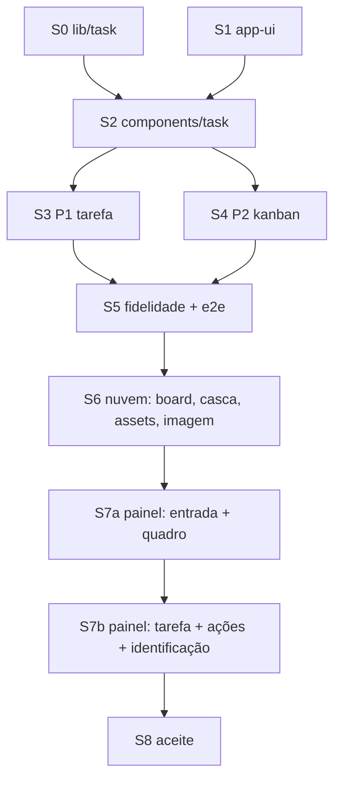

# A tarefa por dentro, o kanban e o painel da nuvem — Implementation Plan

> **Para agentes:** cada slice é um commit (ou poucos) testável sozinho, com RED→GREEN por comportamento. Slice marcado `parallel-*` só sai para subagente com o handoff do slice colado inteiro. O orquestrador verifica todo slice delegado (gates + story renderizada comparada com o PNG da proposta) antes do próximo.

**Goal:** a tarefa vira uma conversa só, com seus artefatos ao lado; a aba Tarefas da conversa vira o kanban por estado vivo; o painel da nuvem deixa de ser um HTML com CSS próprio e passa a ser React com os mesmos componentes do app, servido no mesmo link.

**Spec:** `.specs/2026-11-24-tarefa-e-painel-design.md` (ler inteiro, inclusive a seção "Revisão", antes de qualquer slice).
**Branch:** `feat/tarefa-e-painel` (de `design/painel-e-tarefa` ab662b90). PR A = S0–S5; PR B = S6–S8 (branch `feat/painel-web`, empilhada).
**Referência visual:** `design/proposals/2026-11-24-tarefa-e-painel/*.png` e o frame PROPOSTA do `design/codm.pen` (abrir com `pen interactive` — nunca ler o `.pen` como texto).

**Ambiente para todo comando `bun`:** `env -u NODE_ENV -u CODM_MIGRATIONS_DIR -u CODM_PARENT_PID`. Testes do backend a partir de `packages/api/typescript`; do app a partir de `packages/app/react`; do ui a partir de `packages/app/ui`.

**Gates de todo slice:** `bun tsc` · `bun lint` · testes do slice · `bun x nx run-many -t test --projects=app-react,app-ui` (comparar com a linha de base abaixo) · `bun run detect` (0 erros; `git add -N` nos arquivos novos antes) · nenhum dado real de cliente/pessoa/grupo em fixture ou story (nomes fictícios, os mesmos do pen). Contrato alterado ⇒ `bun emit-openapi && bun sdk` commitados.

**Cerca de todo handoff (decisão 2 do spec):** só `screen-01-detalhe-da-tarefa` e `screen-tarefas-da-conversa` estão descongeladas. **Não alterar** aparência nem story de: `IssuesOverviewSection`, `IssueCard`, `IssueRow` (os selos podem ser reusados como estão), `TranscriptBubble`, `Composer`, `StopAskCard` (só extrair lógica, sem mudar o render), `NeedsYouPanel`, variantes existentes de `Badge`, `board.tsx`, nem qualquer outra tela do `ITEM_PASS`. No ui, só **arquivos novos**.

**Linha de base (24/11, antes do S0):** registrada no fim deste arquivo (seção "Linha de base").

---

## Ordem depois da revisão (24/11 — prevalece sobre as tabelas abaixo)

A spec ganhou "Decisões pós-revisão". As fatias passam a ser seis, cada uma com no máximo 7 entregas. O conteúdo de cada uma vem das seções S* abaixo, ajustado pelas decisões:

- **A0 — contrato** (serial): STEER `failed?`, MESSAGE `artifactId?`, `GetSessionIssues` com campos de vida, `/board` com `openAsks`/`artifactCount`, testes de cada um, `bun emit-openapi && bun sdk`.
- **A1 — base** (S0 + S1): `lib/task` (`TaskColumn`, conversa com `openStopOf`, `artifactGlyph`) e os componentes novos do ui com stories.
- **A2 — tarefa por dentro** (S2 + S3): `TaskActionsContext`, `TaskEventDetail` (feito), `useAnswerAsk` (feito), `TaskConversation`/cartões, P1, tempo real (M3), migração do teste da `IssueTimeline`.
- **A3 — kanban + fidelidade** (S4 + S5): P2 sobre `GetSessionIssues`, `done` na rota, fidelidade (M8), e2e do terminal.
- **B1 — nuvem** (S6): `PanelWebBundle` + `CODM_PANEL_WEB`, casca + CSP, assets, `build.ts` + rail, Dockerfile + `.dockerignore`. A casca ainda aponta para um `index.html` mínimo.
- **B2 — painel React** (S7a + S7b): entrada, `panel.css`, quadro, tarefa, ações, identificação, lote, modo escuro, rail de fecho de imports, testes; depois o S8 (aceite).

## Wave Plan (task-breakdown)

**Feature Type:** 5 — telas novas sobre contratos existentes + um ajuste aditivo de contrato na nuvem + infraestrutura de build/serviço.
**Contextos:** app-ui, app-react (desktop + entrada do painel), `panel` (nuvem), docker.
**Caminho crítico:** `S0 → S2 → S3 → S5` (PR A); `S6 → S7a → S7b → S8` (PR B).

| Slice | Fase | Depende de | Classificação |
|---|---|---|---|
| S0 Lógica pura `lib/task` + chaves i18n `task.*` | 0 | — | serial |
| S1 Componentes novos no `@codm/app-ui` | 1 | — | parallel-after-contract (arquivos disjuntos do S0) |
| S2 Componentes conectados `components/task` + `useAnswerAsk` | 1 | S0, S1 | serial |
| S3 Desktop P1 — tarefa por dentro | 1 | S2 | serial |
| S4 Desktop P2 — kanban da conversa | 1 | S2 | parallel-after-contract (arquivos disjuntos do S3; merge depois do S3 por causa do `useThreadRealtime.ts`) |
| S5 Fidelidade + e2e do terminal | 3 | S3, S4 | serial |
| S6 Nuvem: campos do `/board`, casca, assets, build, imagem | 2 | — (PR B, base S5) | serial |
| S7a Painel web: entrada, build, quadro, cabeçalho, cerca | 1 | S2, S6 | serial |
| S7b Painel web: tarefa, perguntas/ações, identificação, lote | 1 | S7a | serial |
| S8 Aceite: imagem local, gates completos, PRs | 3 | todos | serial |

**Donos de arquivo:** `useThreadRealtime.ts` — S3 (timeline) e depois S4 (overview), nessa ordem; `locales/pt.json`/`en.json` — S0 cria `task.*`; S3/S4/S7 só acrescentam chaves dentro do próprio prefixo (`session.*` existente, `panel.*` novo), um escritor por vez; `StopAskCard/index.tsx` — só S2; `PanelPage.ts`, `GetPanelBoard.ts`, `build.ts`, `cloud.Dockerfile` — só S6; `fidelity-allowlists.ts`, `pencil-export.ts`, `codm.pen` — só S5.

---

## S0 — Lógica pura e catálogo (serial)

Entregas (spec §2):
1. `packages/app/react/src/lib/task/issueBoard.ts` — `BoardColumn` (`queued｜working｜needsYou｜waiting｜stalled｜done`), `BOARD_COLUMNS` (ordem), `BOARD_COLUMN_OF: Record<IssueLifeState, BoardColumn>`.
2. `packages/app/react/src/lib/task/taskConversation.ts` — `ConversationItem` (união discriminada: `person`, `agent`, `steer`, `event`, `artifact`, `ask`, `stop`) e `buildConversation(items, join?)` com despacho `Record<IssueTimelineItemKind, …>`; regras do spec §2 (dedupe mensagem+artefato, lembrete vira evento, `STOP_RAISED` aberto vira `ask`/`stop` pelo `openStopIds`).
3. Testes: `issueBoard.test.ts` (todo membro do enum mapeado; ordem), `taskConversation.test.ts` (um item de cada `kind`; junção de remetente; dedupe; orientação falhada por `sentAt`).
4. Catálogo `task.*` em pt/en: rótulos das colunas, "Conversa", "Artefatos · {{count}}", "Sessão", "Detalhes", "Pedida por", "Agente", "Tentativas", "Lote", "Expandir", "Concluídas · {{count}}", metas dos cartões ("nova tentativa às {{time}}", "volta às {{time}}", "escalada pelo supervisor", "pausada", "{{count}} artefatos"), rótulos de papel da nuvem ("No grupo", "codm").

Os tipos de entrada vêm do SDK (`GetIssueTimelineQueryResponse['items'][number]`), nunca redeclarados.

## S1 — Componentes novos no `@codm/app-ui` (parallel-after-contract)

Entregas (spec §1): `status-pill.tsx`, `chat-bubble.tsx` (`ChatBubble` + `ChatEvent`), `ask-card.tsx`, `artifact-tile.tsx` (`ArtifactTile` + `ArtifactChip`), `task-card.tsx`, `kanban.tsx` (`KanbanColumn` + `KanbanColumnHeader`, compondo `Board*` sem alterá-lo), `steer-composer.tsx` — cada um com story em `components/stories/` e teste quando tem variante.

**Handoff S1** (colar inteiro no subagente):
- Repo `/Users/gabriel/Desktop/Projetos/codm/.claude/worktrees/release-v0.10.0`, branch `feat/tarefa-e-painel`. Ler `CLAUDE.md`, `docs/FRONTEND.md`, `.claude/skills/primitive/SKILL.md` + registry, `.claude/skills/storybook/SKILL.md`, `packages/app/ui/src/components/badge.tsx`, `board.tsx`, `surfaces.ts`, `packages/app/ui/styles/tokens.css`, `web-utilities.css`, `packages/app/react/src/index.css` (utilitários `@theme`), `packages/app/ui/tests/architecture/primitive-props.test.ts`.
- Referência visual: `design/proposals/2026-11-24-tarefa-e-painel/01-componentes.png`, `03-…`, `04-…`, `07-…`. Medidas do pen: bolha raio `[18,18,18,6]` (canto inferior-esquerdo pequeno) padding 11×15, texto 14/1.45; pessoa fundo `--secondary`, nome verde 11.5 bold; agente fundo `--primary`, texto `--primary-foreground`; orientação fundo `--background` borda `--input` itálico 13.5 com cabeçalho "↳ Orientação · Nome" 11.5 bold e recibo (✓✓ verde + texto 10.5 `--caption-foreground`); evento: ponto 6 px `--primary` + texto mono 11.5 `--muted-foreground`. Cartão de decisão: fundo `--foreground`, raio `[20,20,20,7]`, padding 18, gap 12; cabeçalho ponto `--success-bright` + código mono 12 bold `--success-bright` + tipo 12 `--on-dark-muted` + idade à direita; pergunta 15 semibold branca; botão primário verde e secundário contorno `--fg-inverse-20` texto branco, altura 38, raio `[16,16,16,5]`; nota 12 `--on-dark-muted`. Tile: borda `--border`, raio `[16,16,16,5]`, miniatura 92 px (`--accent` para link, `--card` para os outros) com glifo 22 px, nome 13 bold, rodapé tipo 11 semibold + hora 10.5. Chip: card 40×40 glifo + nome 13 bold + detalhe mono 10.5 + ícone de abrir. Cartão de tarefa: borda `--border`, raio `[16,16,16,5]`, padding 13×14, chave mono 12 bold `--muted-foreground`, título 15 bold (14 no kanban), meta 12 com ícone 13 (tons: padrão `--caption-foreground`, forte `--foreground` semibold, aviso `--attention-foreground`), `selected` = borda 1.5 `--foreground`. Coluna: fundo `--card`, raio `[18,18,18,6]`, padding 8, gap 8; cabeçalho 30 px ponto 7 + título 12.5 bold + contagem 12 bold `--caption-foreground`; `emphasis` = cabeçalho com fundo `--foreground` e texto branco. Compositor: campo 48 px borda `--input` raio `[16,16,16,5]` + botão enviar 36×36 verde com seta; dica 12 `--muted-foreground`. Pill: altura 26, raio `[11,11,11,4]`, ponto 7 + rótulo 12 bold; tons: working (`--muted`, ponto `--primary`), needsYou (fundo `--foreground`, ponto `--success-bright`, texto branco), queued (ponto `--caption-foreground`), waiting (ponto `--status-paused`), stalled (fundo `--attention-surface`, ponto `--status-attention`, texto `--attention-foreground`), done (texto `--muted-foreground`, ponto `--fg-20`).
- Regras: arquivos **novos** apenas; nada de `t()` nem SDK nem router (texto e link por prop/`render`); props estendem o root (`ComponentProps<'div'>` etc.), `className` por `cn`; variantes por `cva`; nenhum token novo, nenhum valor arbitrário montado em runtime (Tailwind lê o fonte); `data-slot` em cada raiz; acessibilidade: botões reais, `aria-label` vindo por prop.
- Stories `UI/<Nome>` com `args` cobrindo cada tom/variante; testes `components/<nome>.test.tsx` no estilo de `badge.test.tsx` para variantes e `locked`.
- Pronto quando: `cd packages/app/ui && bun test` verde, `bun tsc` e `bun lint` verdes, `bun x nx run app-react:storybook:build` (ou o alvo equivalente) compila; devolver lista de arquivos e um print de cada story (`bun probe <storyId>` ou screenshot do storybook).
- Fora: qualquer arquivo fora de `packages/app/ui/src/components/`.

## S2 — Componentes conectados e lógica de resposta (serial)

1. `packages/app/react/src/components/task/TaskConversation.tsx` — renderiza `ConversationItem[]` com os primitivos do S1; eventos com o texto das chaves `session.timeline*` existentes; `PUBLISH_RAN` com mostrar/ocultar saída (`useGetPublishRunOutput`, só quando `publishOutput` vem habilitado por prop); `BATCH_LINKED` com link por `render`.
2. `TaskAskCard.tsx` (opção + texto via TanStack Form, nota do padrão, trava) e `TaskStopCard.tsx` (resoluções por `enums.StopResolution`) — ações por prop (`onAnswer`, `onResolve`, `pending`).
3. `TaskCardMeta.ts` — meta do cartão por coluna (spec §4), pura, testada.
4. `hooks/useAnswerAsk.ts` — lógica de `StopAskCard` extraída (validação por `answerStopMutationRequestSchema`, invalidações); `StopAskCard` passa a usar o hook **sem mudar o render** (story e teste existentes ficam verdes sem edição).
5. Stories (`connected` onde há SDK) e testes pelo harness.

## S3 — Desktop P1 (serial)

1. `IssueDetailSection/index.tsx` reescrito conforme a tabela do spec §3 (cabeçalho, conversa, lateral com Artefatos/Sessão/Detalhes, compositor). `IssueTimeline.tsx` deixa de ser montado na página (o arquivo fica até o S5 decidir; seu teste continua verde).
2. `TerminalPanel` movido para a lateral com **uma** montagem de `useTerminalStream`, aberto por padrão, mesmos `data-testid`; "Expandir" só aumenta a altura.
3. `useThreadRealtime.threadInvalidations` + teste: invalidação do prefixo das timelines.
4. Chaves novas em `session.*`/`task.*` (pt/en).
5. Story `issue-detail.stories.tsx` (`Full`) com mocks de timeline, artefatos, needsYou e chat; teste do harness (abre a tarefa, conversa na ordem, decisão responde com o corpo exato, artefato da tarefa na lateral, orientação envia).

## S4 — Desktop P2 (parallel-after-contract)

1. `SessionIssuesSection/index.tsx` → kanban (`KanbanColumn` + `TaskCard` + `TaskCardMeta`), dados do `useGetIssuesOverview` filtrados por `threadId`; resumo; "Concluídas · N" alterna o parâmetro de busca `done` (schema da rota com `.default(false)`).
2. `useThreadRealtime`: `getIssuesOverviewQueryKey` nos casos do `getSessionIssuesQueryKey` (merge depois do S3).
3. Story `issues.stories.tsx` (`TarefasDaConversa`) e teste do harness (colunas, meta por coluna, link concluídas, clique navega).

**Handoff S4** (colar inteiro): mesmo cabeçalho de leitura do S1 + `docs/FRONTEND.md` (rotas/search params) + `packages/app/react/CLAUDE.md` + spec §4 e §2 + `src/lib/task/*` e `src/components/task/*` do S0/S2 já commitados + `routes/(app)/issues/-components/IssuesOverviewSection` (só leitura, **não alterar**) + PNG `02-desktop-tarefas-kanban.png`. Cerca de arquivo: só `SessionIssuesSection/**`, o `validateSearch` da rota da aba Tarefas, `issues.stories.tsx`, chaves `task.*` novas, e — depois do S3 — o caso novo no `useThreadRealtime`. Pronto quando: gates do plano verdes + print da story comparado ao PNG.

## S5 — Fidelidade e e2e do terminal (serial)

1. `fidelity-allowlists.ts`: remover as duas entradas (commit com a referência à decisão 2 do spec).
2. `codm.pen` (via `pen interactive --app desktop` ou headless): mover P1 e P2 para dentro de **Mesclado / Tarefa & Config da conversa** e **Mesclado / Conversa**, no lugar de `Screen — 01 · Detalhe da tarefa` e `Screen / Tarefas da conversa`, com esses mesmos nomes.
3. `pencil-export.ts`: `--only=<slug,…>` (filtro puro exportado + teste); reexportar spec + alvo das duas telas.
4. `bun fidelity` das duas telas; placar no PR.
5. e2e `10-terminal-tool-frame` e `92-demo-attach-artefato` rodados (ou registrar no PR por que não).

## S6 — Nuvem (serial, PR B)

1. `GetPanelBoard`: `openAsk?` e `artifactCount` por issue (spec §5) + teste; `bun emit-openapi && bun sdk`.
2. Porta `PanelWebBundle` (`panel/services/PanelWebBundle/`) com bindings `mock`/`integration`/`real` (real: `node:fs`, lido uma vez; perfil cloud de produção sem bundle ⇒ boot falha; `dev:cloud` ⇒ 503 com a instrução).
3. `PanelPage` devolve a casca com os cabeçalhos do spec §6 (+ CSP).
4. Controller `GET /panel/assets/:file` — só nomes do manifesto.
5. `scripts/build.ts` do api: copia `packages/app/react/dist-panel` → `dist/panel-web` com `CODM_BUILD_PANEL_WEB=1`; rail `build-output.test.ts` estendido.
6. `docker/cloud.Dockerfile`: estágio `panel-web` + cópia para o builder + `ENV CODM_BUILD_PANEL_WEB=1` no build.
7. `PanelPage.test.ts` reescrito (cabeçalhos, CSP, assets recusam travessia).

(O `build:panel` do S7a precisa existir para o estágio do Docker; o S6 cria um `vite.panel.config.ts` mínimo + `index.html` com "carregando" para o build ter o que empacotar, e o S7a o preenche.)

## S7a — Painel web: entrada e quadro (serial)

1. `vite.panel.config.ts` + `build:panel` + alvo nx `build-panel` (registrado conforme `test-liveness`/`registry-pointers`).
2. `src/panel/main.tsx`, `PanelApp.tsx` (QueryClient, i18n, CSS, SDK `typescript-cloud` com base relativa, token lido do caminho).
3. Quadro: cabeçalho (grupo, contagens, saúde, lote, identidade), 6 colunas largo / abas + snap no celular; estados "link inválido" e "sem contato há N min"; recarga a cada 15 s (comentário justificando: sem SSE no painel).
4. Rail `panel-web-fence.test.ts` (imports proibidos, `dangerouslySetInnerHTML`).
5. Catálogo `panel.*` (pt/en).
6. Testes em happy-dom com SDK mockado.

## S7b — Painel web: tarefa e ações (serial)

1. Tarefa por hash `#KEY` (e o hash refletindo a tarefa aberta): celular com abas Conversa/Artefatos; largo com lista + conversa + lateral.
2. Perguntas/paradas/pausar/orientar por `POST /actions`; situação da ação por `GET /actions/:id` (3 s até 4 min).
3. Identificar-me (folha via `useDialogStore`): membros → código → confirmar; sair.
4. Lote `#L-n` (diálogo).
5. Erros pelo catálogo `errors.*` (`errorTranslator`).
6. Testes: abrir por hash, responder pergunta (corpo exato), trava de liberação, identificar e sair, lote.

## S8 — Aceite (serial)

1. `docker build -f docker/cloud.Dockerfile -t codm-cloud:panel .` e subir com um Postgres descartável (`bun migrate:deploy:cloud` nele): `curl` da casca (cabeçalhos + CSP) e de um asset do manifesto (200, imutável) e de um nome fora do manifesto (404). Se faltar disco/Docker, registrar no PR como não verificado.
2. Gates completos (`bun tsc`, `bun lint`, `bun run test`, `bun run detect`).
3. PR A e PR B em rascunho, com prints (stories desktop, painel largo e celular) e a lista de cortes declarados.

## Determinism check

Cada slice tem dono de arquivo único; os dois pontos de contenção (`useThreadRealtime.ts`, catálogos) têm ordem de merge fixa; nenhum slice paralelo toca arquivo de outro; contratos mudam só no S6 (aditivo, nuvem).

## Linha de base

24/11, `feat/tarefa-e-painel` ab662b90, `bun x nx run-many -t test --projects=app-react,app-ui --skip-nx-cache`:
- app-ui: 22 pass, 0 fail.
- app-react: 344 pass, 0 fail no `bun test`; no `test:cross-service`, 8 arquivos PASS e **1 FAIL conhecido** — `SessionChatSection/index.services.test.tsx` ("SessionChatSection nunca saiu do skeleton"), que falha igual em `main` e em `v0.9.0`. Qualquer outra falha é regressão nossa.
